# PATHSNAP

Distributed map matching and route reconstruction

## 1. Objective and delivered system

Given noisy GPS observations and a directed road network, choose a road arc for every observation and reconstruct a feasible route. The system compares five classifier families, selects and calibrates a model using training-trip validation, then decodes a weighted HMM-style sequence with Viterbi. A browser dashboard demonstrates every family and the final tuned/calibrated configuration.

All results use the organiser's train and student-test partitions. Evaluator-test data was not accessed. Point labels are approximate ordered-route alignments, not supplied point-level ground truth. Student test is a development holdout, not proof of deployment accuracy. Family selection, tuning and candidate configuration share training evidence; CV estimates are not nested or fully independent.

Code, analysis and report drafting used Codex AI assistance. The team remains responsible for reviewing, understanding and reproducing the work. No member names or physical second-laptop evidence are invented.

## 2.1 Data and method overview

Each trip supplies headerless track (longitude, latitude, timestamp), nodes (longitude, latitude), directed arcs (from-node, to-node), and a shorter ordered reference route of local arc IDs. Loaders check finite coordinates and identifier ranges. Inference reads track, nodes and arcs only. Offline training aligns observations to ordered route occurrences; server-side evaluation opens the reference only after inference.

Pipeline: local metric projection -> indexed candidates -> twelve schema features -> positive candidate probabilities -> per-point classifier choices / directed HMM -> separate reference evaluation -> API -> dashboard. No saved prediction file substitutes for a live request.

## 2.2 Dataset understanding and exploratory analysis

### Preprocessing and partition inventory

Strict loaders validate the documented headerless whitespace files: track
longitude/latitude/time, node longitude/latitude, directed arc node IDs and an
ordered route of arc IDs. All IDs are zero-based file-row numbers local to a trip.
There is no row-to-row correspondence between track and route. Raw data and
regenerable tables stay local. File-by-file sizes, row counts and dtypes are in
`results/metrics/inventory.csv`; SHA-256 inputs are in `data_manifest.csv`.

| partition | trips | observations | min_observations | median_observations | max_observations | nodes | arcs | missing_values | large_gaps | broken_route_links |
| --- | --- | --- | --- | --- | --- | --- | --- | --- | --- | --- |
| student_test | 10 | 19160 | 262 | 1420.0000 | 3958 | 90689 | 185041 | 0 | 44 | 1 |
| train | 80 | 208417 | 361 | 1529.0000 | 19313 | 1933485 | 3876904 | 0 | 1216 | 13 |

Only train and student-test partitions appear in this analysis. Timestamps and
GPS observations are preserved in original order, without silent imputation or
resampling. There are 0 duplicate and
0 decreasing timestamp steps across these
validated development trips. Gaps greater than 5 s are flagged for downstream
sequence handling. Actual interval frequencies, rather than averages of trip
percentages, give this point-weighted sampling summary:

| partition | intervals | one_second_share | maximum_gap_s |
| --- | --- | --- | --- |
| student_test | 19150.0000 | 0.9862 | 210.0000 |
| train | 208337.0000 | 0.9650 | 153064.0000 |

The largest training interval is 153,064 s
(42.5 hours), versus
210 s in student test. A displacement-derived speed across a large gap is an interval
average, not a reliable instantaneous vehicle speed. The gap flag is available
to the decoder; no points are deleted to hide these interruptions.

Directed graph diagnostics include weak and strong components, isolated nodes,
reverse-arc share and zero-length arcs for every trip in `quality_report.csv`.
The reference route contains 14 head-to-tail breaks
across development trips. These are supplied reference limitations; the loader
does not insert artificial road connections.

### Geometry, features and why they were chosen

Each trip uses a local azimuthal equidistant projection centred on mean latitude
and circular-mean longitude, in metres with explicit longitude/latitude ordering.
This accommodates trips in different regions and avoids comparing degrees as
Euclidean metres. Exact CRS strings are saved per trip. Up to 1,000 evenly
spaced road arcs per trip were compared with WGS84 geodesic length; maximum
sampled relative discrepancy across development trips was
0.000668%. This checks these networks,
not arbitrary long-distance extrapolation.

The twelve input features are GPS-to-segment distance, projected fraction along
the arc, heading disagreement, heading validity, speed, arc length, distance rank,
start-node incoming degree, end-node outgoing degree, time gap, large-gap flag and
outside-radius fallback flag. Distance anchors proximity; heading separates
opposite directions; fraction/length/rank describe local geometry; degrees expose
junction context; speed/gaps indicate motion and temporal reliability. Invalid
headings carry a validity flag. Only the training fold fits the scaler.
IDs, reference route positions, labels and partition names are never model inputs.
Full definitions and units are in `report/member1/README.md`.

### Observation-label alignment and its limits

The supplied reference is an ordered arc sequence, not a label per GPS row.
An offline dynamic program aligns observations to route occurrences in
nondecreasing order, permitting skipped short arcs and repeated arc IDs. Its
cost is point-to-segment distance plus a fixed 15 m heading disagreement term
`15*(1-cos(delta))` when movement supplies a valid heading. Start/end route
positions are unconstrained. Assignments farther than 100 m are unknown.

| partition | n_obs | unknown_labels | skipped_route_occurrences |
| --- | --- | --- | --- |
| student_test | 19160 | 17 | 387 |
| train | 208417 | 20540 | 3048 |

Unknown labels are stored as `ref_arc=-1` / `is_ref=-1` and excluded from fitting
and candidate classification metrics; they are never silently negative examples.
Nearest-reference diagnostics independently show whether errors come from route
ordering or from the GPS being far from the entire supplied route:

| partition | trip_id | nearest_reference_median_m | nearest_reference_over100m |
| --- | --- | --- | --- |
| train | 00000054 | 138.6163 | 16157 |
| train | 00000033 | 122.4213 | 2978 |
| train | 00000002 | 5.6746 | 719 |
| train | 00000043 | 10.9876 | 60 |
| train | 00000019 | 5.5098 | 21 |

These measurements support an offset/reference mismatch in the largest outliers;
they do not establish which input is physically correct. Alignment can remain
ambiguous around parallel roads, junctions, loops, gaps, and broken reference
links. Progress within one arc occurrence is not constrained. Features also
include distance and heading, so pointwise model scores partly measure agreement
with this surrogate alignment. Unknown exclusions change the evaluated population.
Original-route sequence metrics remain necessary in Member 3's evaluation.

### Candidate selection and error ceiling

An STRtree indexes complete arc segments. Search includes arcs within a metric
radius, sorts by exact segment distance then arc ID, and caps candidates at K.
If the radius is empty, the nearest segment is returned without consulting labels.
The full training-only sweep is:

| radius_m | k | candidate_miss_rate | mean_candidates |
| --- | --- | --- | --- |
| 25 | 4 | 0.0474 | 3.0252 |
| 25 | 8 | 0.0261 | 4.0035 |
| 25 | 16 | 0.0227 | 4.5030 |
| 50 | 4 | 0.0420 | 3.4375 |
| 50 | 8 | 0.0181 | 5.3971 |
| 50 | 16 | 0.0136 | 7.4462 |
| 100 | 4 | 0.0408 | 3.6926 |
| 100 | 8 | 0.0149 | 6.5337 |
| 100 | 16 | 0.0095 | 10.8602 |

The fixed policy selects the smallest mean candidate count with <=1% known-label
miss rate, otherwise the lowest miss rate. It selected 100 m /
K=16, with 0.9543% known-label misses and
10.860 candidates per observation. The corresponding
known-label training Top-1 ceiling is 99.0457%.
Student-test labels did not choose this configuration. The sweep uses all
training trips before model CV; model CV is conditional on that frozen candidate
configuration, not a nested unbiased estimate of candidate-parameter selection.

### Visual evidence

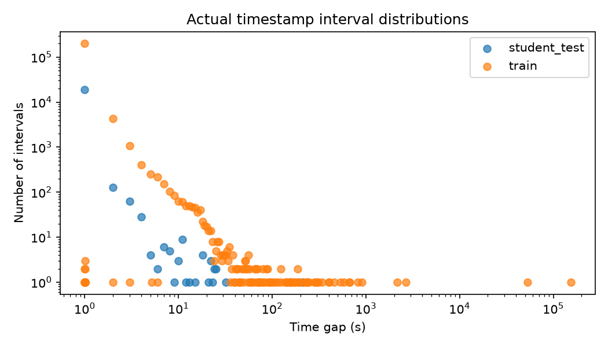
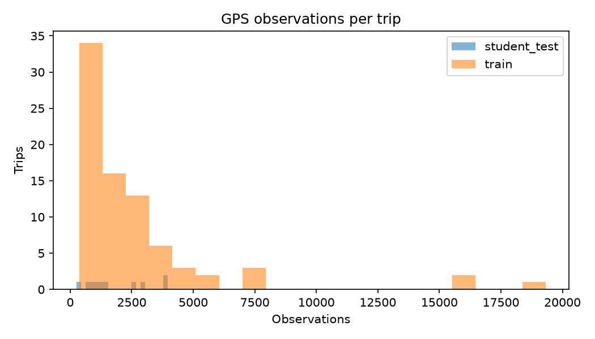
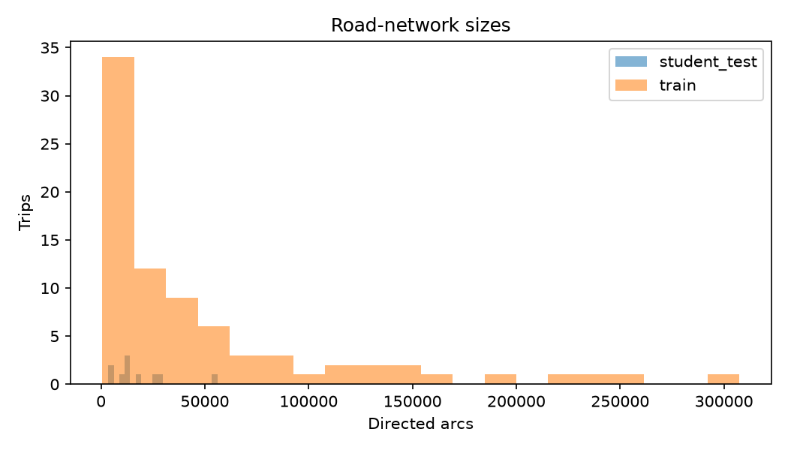
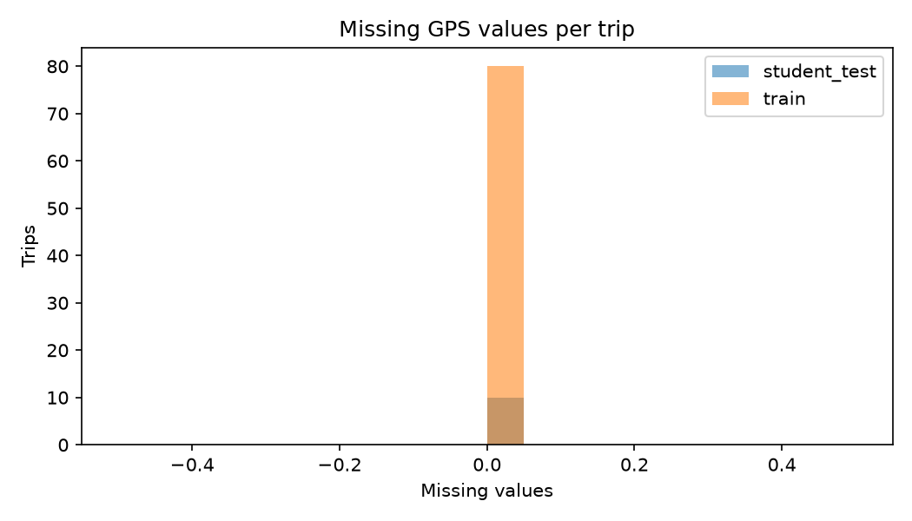
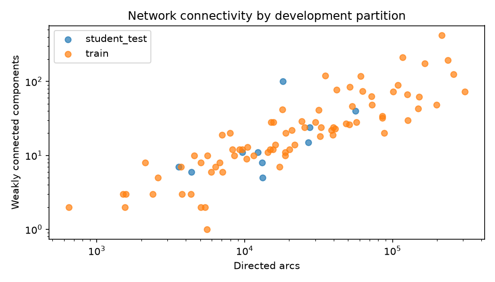
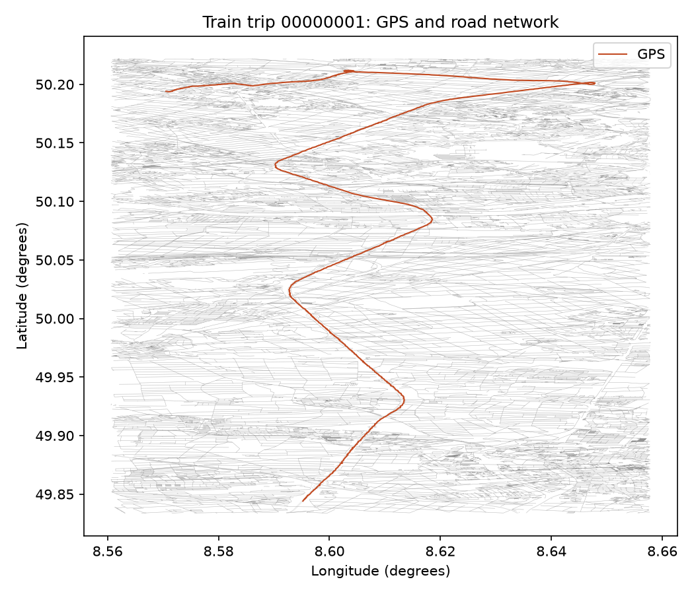
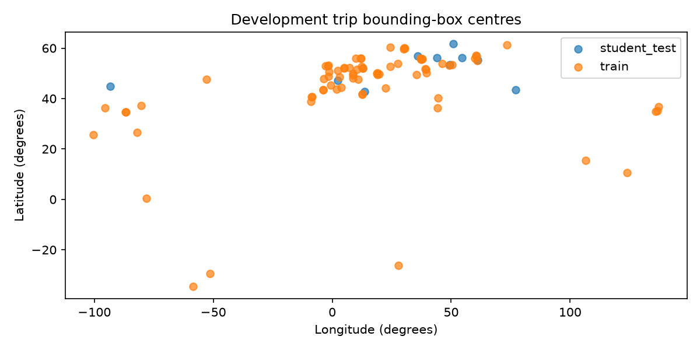
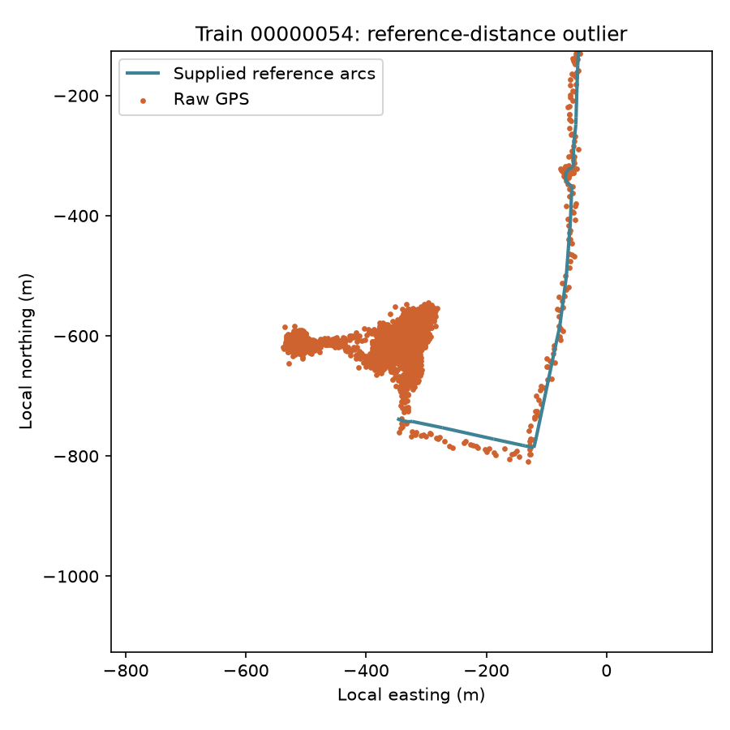
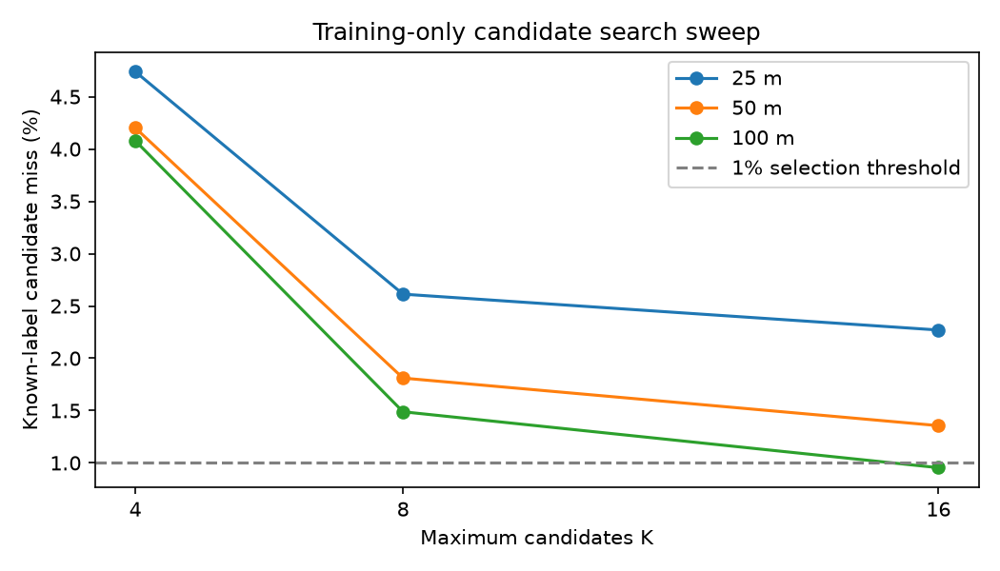

The train-only interactive GPS/network map is
[`maps/eda_train_00000001.html`](../../maps/eda_train_00000001.html), with separate
layers, extent and legend. `notebooks/01_eda.ipynb` reads the inventory and diagnostic
outputs. Member 3 adds reference and prediction layers for decoder comparisons.


## 3.1 Consolidated comparison and selection

The five distinct families are Logistic Regression, KNN, Random Forest,
histogram gradient boosting and MLP. A tuned variant is a separate row, not a
sixth distinct baseline family. All use the same schema and frozen five trip
folds over the 80 training trips. Known-label training rows total 2,134,559;
20,540 training and 17 student-test observations have unknown alignment labels.
`-1` never enters supervised fitting or candidate metrics. Top-1 counts missing
reference candidates as incorrect and excludes only unknown reference labels.

The comparison rows below are **before post-selection sigmoid calibration**.
Final exported metrics are reported in section 4 and `final_export_metrics.csv`.

| Model | CV Macro-F1 | CV Top-1 | Student Top-1 | Direct continuity | Student Macro-F1 | Log loss | Inference (s) |
| --- | --- | --- | --- | --- | --- | --- | --- |
| hist_gradient_boosting_tuned | 0.8304 | 0.7735 | 0.8036 | 0.9038 | 0.8360 | 0.1545 | 0.8489 |
| hist_gradient_boosting | 0.8236 | 0.7724 | 0.8041 | 0.9030 | 0.8304 | 0.1651 | 0.4728 |
| random_forest | 0.8373 | 0.7724 | 0.8010 | 0.9017 | 0.8428 | 0.1519 | 0.8056 |
| mlp | 0.8694 | 0.7703 | 0.7969 | 0.9023 | 0.8866 | 0.0834 | 0.0436 |
| logistic_regression | 0.7507 | 0.7607 | 0.7926 | 0.8940 | 0.7502 | 0.2345 | 0.0072 |
| knn | 0.8599 | 0.7539 | 0.7874 | 0.8909 | 0.8788 | 0.2455 | 150.0669 |

The primary metric is mean fold observation Top-1: one candidate road arc must be
chosen per GPS observation. Candidate Macro-F1 measures performance despite many
negative rows; log loss, Brier score and reliability diagrams assess probability
quality for the decoder. Exact score ties choose the lower arc ID. Preprocessing
is fitted on known-label rows within each training fold only.

The measured baseline CV winner was **hist_gradient_boosting**.
The final family/configuration is **hist_gradient_boosting_tuned**.
Only CV scores choose the family and tuned-versus-untuned configuration; student
test is a reported development holdout, not an optimisation objective. Family
and search selection reuse CV, so these CV values are selection-optimistic, not
nested-CV estimates. Candidate radius/K was already chosen using training-wide
labels; CV remains conditional on that fixed candidate configuration.

Member 1 KNN/MLP results were reused after checking data, schema, folds and source
fingerprints. Their historical CV probabilities were not retained, so their CV
Brier/ECE/continuity remain unavailable. Their saved full-training models were
run on student test to measure those diagnostics consistently for all models.
No absent metric was fabricated or inferred from a confusion matrix.

Route continuity here is a classifier-only B diagnostic: adjacent observation
predictions use the same directed arc or connect head-to-tail. Unknown labels and
large gaps remain in this topology-only metric. Missing observation indexes break
continuity. Short intermediate road arcs can be skipped between GPS observations,
so this direct metric does not establish physical route infeasibility. C1's final
metric, HMM transitions and sequence evaluation remain Member 3's work.

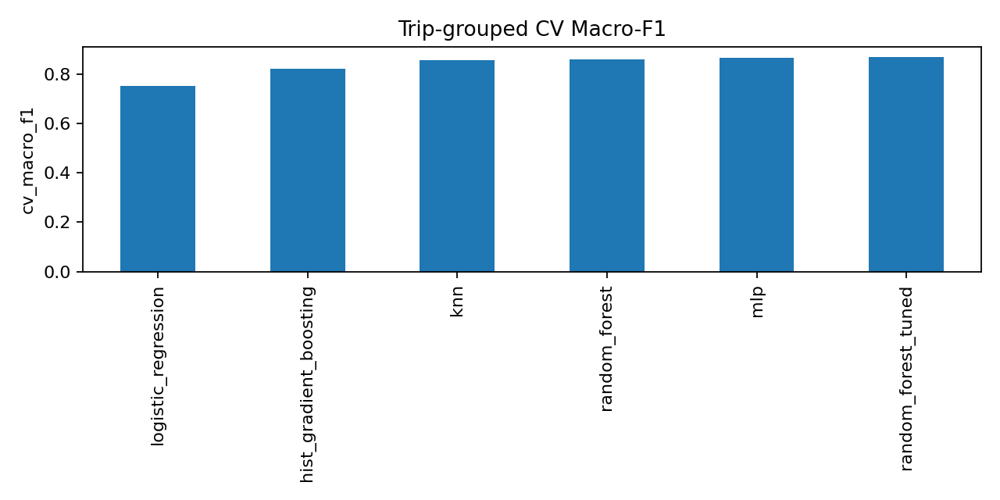
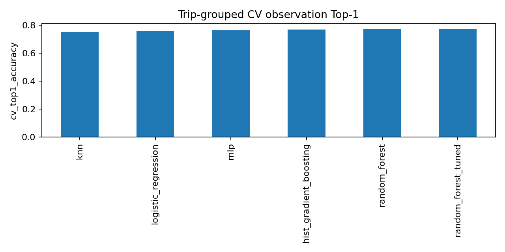
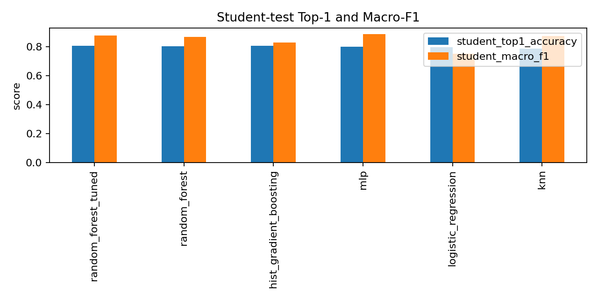
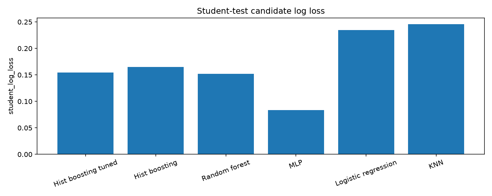
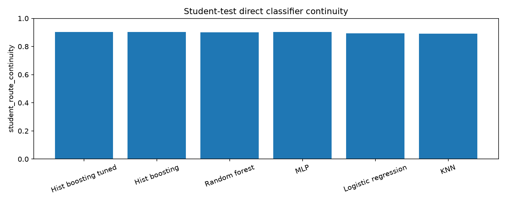

## 3.2 Member 2 model subsections

Member 1's KNN and MLP nine-question sections remain in
`report/member1/eda_and_models.md`. Below are the three additional families.

### Hist boosting

1. **Suitability.** Histogram boosting can learn nonlinear feature combinations with efficient tabular-data fitting.
2. **Strengths and limitations.** Sequential tree corrections are expressive and compact. Learning rate, leaf count and iteration count control capacity. Row-level early stopping is disabled to keep trips out of internal mixed partitions.
3. **Inputs.** The twelve frozen geometry/motion/connectivity features. Trip IDs, observation indexes, arc IDs, reference routes and labels are excluded from learned inputs.
4. **Preprocessing and validation.** Logistic Regression uses a fold-fitted StandardScaler; tree families use raw features. Five trip-grouped folds hold out 16 trips each; no row-level split mixes trips. Final refit used 2,134,559 known candidate rows from 80 trips.
5. **Initial configuration.** Exact recorded parameters follow below. The Random Forest's bootstrap fraction limits rows per tree, not the set of training trips admitted to the fit.
6. **Objective.** Weighted binary log loss with L2 leaf regularisation; histogram-based gradient boosting.
7. **Student-test results.** Candidate accuracy 93.2741%, positive precision 0.5544, recall 0.9446, F1 0.6987; known observations 19,143, unknown observations 17; candidate miss rate 0.0261%.
8. **Required metrics.** Student Top-1 80.4054%, Macro-F1 0.8304, log loss 0.1651. CV Macro-F1 0.8236 (fold SD 0.0104); CV Top-1 77.2413%. Refit 17.399 s; student inference 0.473 s for 231,905 candidate rows. Timings exclude loading, feature generation and HMM decoding.
9. **Fit/generalisation evidence.** This diagnostic/CV gap does not show strong overfitting at this configuration; it does not rule out underfitting or probability-threshold effects. The <=10k fitted-row diagnostic Macro-F1 was 0.8360, a +0.0124 difference from grouped CV. It is optimistic because these rows entered fitting. Fold Macro-F1 ranged 0.8172–0.8420. This measured gap and fold spread guide overfitting assessment; training score alone cannot establish generalisation or rule out underfitting. Refit warnings: none.

```json
{
  "categorical_features": "from_dtype",
  "class_weight": "balanced",
  "early_stopping": false,
  "interaction_cst": null,
  "l2_regularization": 1.0,
  "learning_rate": 0.1,
  "loss": "log_loss",
  "max_bins": 255,
  "max_depth": null,
  "max_features": 1.0,
  "max_iter": 100,
  "max_leaf_nodes": 31,
  "min_samples_leaf": 20,
  "monotonic_cst": null,
  "n_iter_no_change": 10,
  "random_state": 42,
  "scoring": "loss",
  "tol": 1e-07,
  "validation_fraction": 0.1,
  "verbose": 0,
  "warm_start": false
}
```

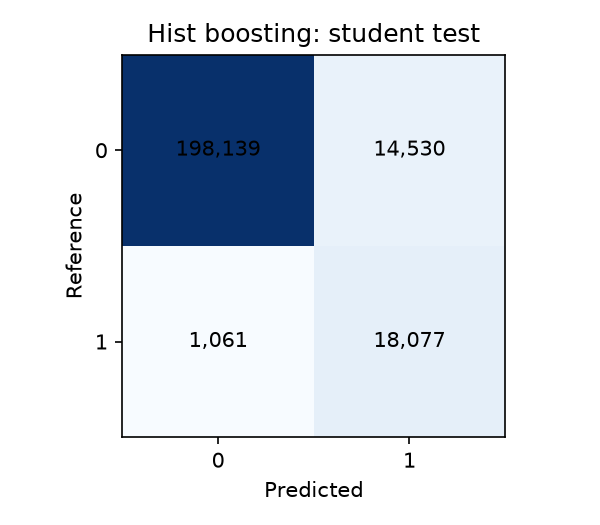

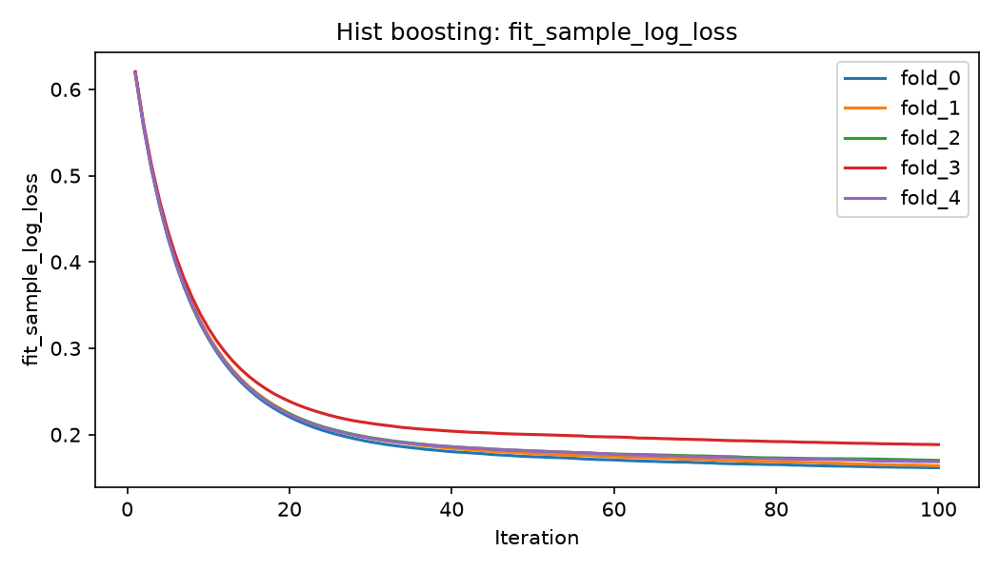

### Logistic regression

1. **Suitability.** A scaled linear scorer gives a fast, interpretable reference for ranking nearby arcs.
2. **Strengths and limitations.** It trains and scores compactly but cannot represent arbitrary nonlinear geometry/heading interactions. Balanced class weights affect its probability prior; calibration is assessed explicitly.
3. **Inputs.** The twelve frozen geometry/motion/connectivity features. Trip IDs, observation indexes, arc IDs, reference routes and labels are excluded from learned inputs.
4. **Preprocessing and validation.** Logistic Regression uses a fold-fitted StandardScaler; tree families use raw features. Five trip-grouped folds hold out 16 trips each; no row-level split mixes trips. Final refit used 2,134,559 known candidate rows from 80 trips.
5. **Initial configuration.** Exact recorded parameters follow below. The Random Forest's bootstrap fraction limits rows per tree, not the set of training trips admitted to the fit.
6. **Objective.** Weighted binary logistic loss with L2 regularisation, optimised by L-BFGS.
7. **Student-test results.** Candidate accuracy 88.2057%, positive precision 0.4073, recall 0.9418, F1 0.5687; known observations 19,143, unknown observations 17; candidate miss rate 0.0261%.
8. **Required metrics.** Student Top-1 79.2561%, Macro-F1 0.7502, log loss 0.2345. CV Macro-F1 0.7507 (fold SD 0.0098); CV Top-1 76.0701%. Refit 1.075 s; student inference 0.007 s for 231,905 candidate rows. Timings exclude loading, feature generation and HMM decoding.
9. **Fit/generalisation evidence.** This diagnostic/CV gap does not show strong overfitting at this configuration; it does not rule out underfitting or probability-threshold effects. The <=10k fitted-row diagnostic Macro-F1 was 0.7553, a +0.0046 difference from grouped CV. It is optimistic because these rows entered fitting. Fold Macro-F1 ranged 0.7363–0.7600. This measured gap and fold spread guide overfitting assessment; training score alone cannot establish generalisation or rule out underfitting. Refit warnings: none.

```json
{
  "memory": null,
  "steps": [
    [
      "standardscaler",
      "StandardScaler()"
    ],
    [
      "logisticregression",
      "LogisticRegression(class_weight='balanced', max_iter=1000, random_state=42)"
    ]
  ],
  "transform_input": null,
  "verbose": false,
  "standardscaler": "StandardScaler()",
  "logisticregression": "LogisticRegression(class_weight='balanced', max_iter=1000, random_state=42)",
  "standardscaler__copy": true,
  "standardscaler__with_mean": true,
  "standardscaler__with_std": true,
  "logisticregression__C": 1.0,
  "logisticregression__class_weight": "balanced",
  "logisticregression__dual": false,
  "logisticregression__fit_intercept": true,
  "logisticregression__intercept_scaling": 1,
  "logisticregression__l1_ratio": 0.0,
  "logisticregression__max_iter": 1000,
  "logisticregression__n_jobs": null,
  "logisticregression__penalty": "deprecated",
  "logisticregression__random_state": 42,
  "logisticregression__solver": "lbfgs",
  "logisticregression__tol": 0.0001,
  "logisticregression__verbose": 0,
  "logisticregression__warm_start": false
}
```

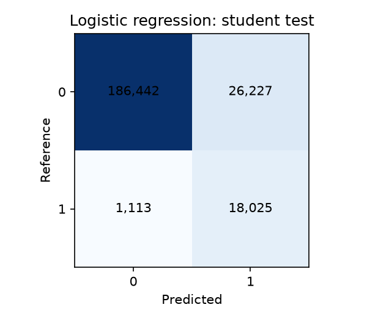

### Random forest

1. **Suitability.** Trees can learn nonlinear interactions between distance, heading, rank and connectivity without scaling.
2. **Strengths and limitations.** Bootstrap averaging reduces individual-tree variance. Depth, leaf size, tree count and bootstrap fraction bound compute and export size; probabilities can still be distorted by class weighting.
3. **Inputs.** The twelve frozen geometry/motion/connectivity features. Trip IDs, observation indexes, arc IDs, reference routes and labels are excluded from learned inputs.
4. **Preprocessing and validation.** Logistic Regression uses a fold-fitted StandardScaler; tree families use raw features. Five trip-grouped folds hold out 16 trips each; no row-level split mixes trips. Final refit used 2,134,559 known candidate rows from 80 trips.
5. **Initial configuration.** Exact recorded parameters follow below. The Random Forest's bootstrap fraction limits rows per tree, not the set of training trips admitted to the fit.
6. **Objective.** Bootstrap decision trees minimise weighted Gini impurity; their positive probabilities are averaged. It has no epoch loss curve.
7. **Student-test results.** Candidate accuracy 93.9851%, positive precision 0.5851, recall 0.9332, F1 0.7192; known observations 19,143, unknown observations 17; candidate miss rate 0.0261%.
8. **Required metrics.** Student Top-1 80.1024%, Macro-F1 0.8428, log loss 0.1519. CV Macro-F1 0.8373 (fold SD 0.0110); CV Top-1 77.2384%. Refit 105.176 s; student inference 0.806 s for 231,905 candidate rows. Timings exclude loading, feature generation and HMM decoding.
9. **Fit/generalisation evidence.** This diagnostic/CV gap does not show strong overfitting at this configuration; it does not rule out underfitting or probability-threshold effects. The <=10k fitted-row diagnostic Macro-F1 was 0.8502, a +0.0129 difference from grouped CV. It is optimistic because these rows entered fitting. Fold Macro-F1 ranged 0.8305–0.8566. This measured gap and fold spread guide overfitting assessment; training score alone cannot establish generalisation or rule out underfitting. Refit warnings: none.

```json
{
  "bootstrap": true,
  "ccp_alpha": 0.0,
  "class_weight": "balanced_subsample",
  "criterion": "gini",
  "max_depth": 14,
  "max_features": "sqrt",
  "max_leaf_nodes": null,
  "max_samples": 0.5,
  "min_impurity_decrease": 0.0,
  "min_samples_leaf": 10,
  "min_samples_split": 2,
  "min_weight_fraction_leaf": 0.0,
  "monotonic_cst": null,
  "n_estimators": 80,
  "n_jobs": 2,
  "oob_score": false,
  "random_state": 42,
  "verbose": 0,
  "warm_start": false
}
```

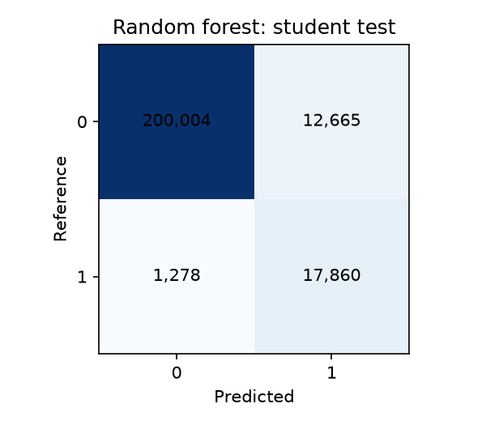

## 3.3 Recorded histories and probability diagnostics

MLP curves come from Member 1's actual epoch objectives. Boosting curves are
actual per-stage empirical log losses on a fixed <=10k subset of that fold's
fitted rows; they are labelled `fit_sample_log_loss` and exclude the L2 penalty.
They are not validation-loss curves. Logistic Regression and Random Forest
have no fabricated epoch histories. Every curve row is in
`results/metrics/model_training_history.csv`.

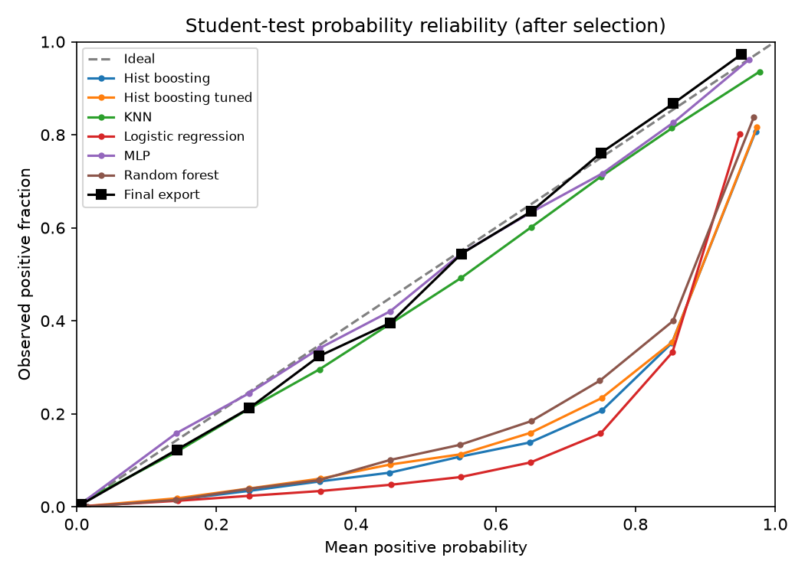


### KNN

1. **Suitability.** Nearby candidate feature patterns can vote for correct-road likelihood without a linear decision boundary.
2. **Strengths and limitations.** Distance weighting adapts locally with no iterative fitting, but irrelevant/scaled dimensions, class imbalance, stored training data and expensive neighbour queries are limitations.
3. **Inputs.** The same twelve schema features above; identifiers and labels are excluded.
4. **Preprocessing and split.** StandardScaler fits only on this fold's known-label training rows. Five grouped folds share no trips. The final refit used 2,134,559 rows from 80 trips; configured sample cap was 0 (0 means all known rows).
5. **Initial hyperparameters.** The exact configuration below was run; no Member 1 Bayesian tuning or final team model selection is claimed.
6. **Objective.** There is no gradient-trained loss: fitting stores examples and a KD-tree. Positive probability is a distance-weighted neighbour vote. No epoch loss curve exists.
7. **Student-test performance.** Candidate accuracy 96.4186%, positive precision 0.7991, recall 0.7563, F1 0.7771. Known observations 19,143; unknown observations excluded 17; candidate miss rate 0.0261%.
8. **Required comparison metrics.** Student Top-1 78.7390%, candidate Macro-F1 0.8788, log loss 0.2455; CV candidate Macro-F1 0.8599 ± 0.0148 (sample standard deviation across five folds). Model-only refit time (excluding scaler fitting) 1.590 s; student inference time 153.167 s for 231,905 candidate rows, excluding raw-data loading, features and decoding.
9. **Fit/generalisation evidence.** The diagnostic exceeds grouped CV by 0.1401; this is consistent with memorisation or overfitting to fitted examples, with the self-neighbour caveat for KNN. The <=10k fit-sample diagnostic Macro-F1 was 1.0000, versus held-out fold range 0.8465–0.8843.  This diagnostic includes KNN self-neighbours and is optimistic. It is not independent evidence of generalisation. The fold spread and student results are the appropriate measured checks. Refit warnings: none.

```json
{
  "algorithm": "kd_tree",
  "leaf_size": 40,
  "metric": "minkowski",
  "metric_params": null,
  "n_jobs": 2,
  "n_neighbors": 15,
  "p": 2,
  "weights": "distance"
}
```

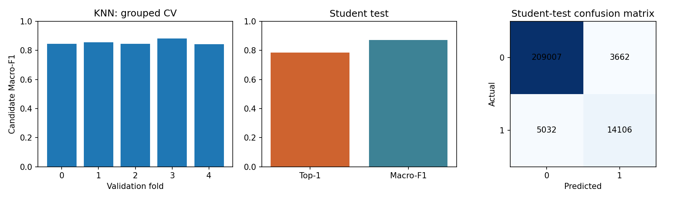

### MLP

1. **Suitability.** A compact nonlinear network can combine proximity, direction and junction features into candidate probabilities.
2. **Strengths and limitations.** The compact network learns nonlinear combinations and has batched inference, but requires scaling, iterative optimisation and regularisation; the recorded convergence warnings must be considered.
3. **Inputs.** The same twelve schema features above; identifiers and labels are excluded.
4. **Preprocessing and split.** StandardScaler fits only on this fold's known-label training rows. Five grouped folds share no trips. The final refit used 2,134,559 rows from 80 trips; configured sample cap was 0 (0 means all known rows).
5. **Initial hyperparameters.** The exact configuration below was run; no Member 1 Bayesian tuning or final team model selection is claimed.
6. **Objective.** Adam minimises binary cross-entropy with L2 regularisation (alpha=0.001). No random observation-level internal validation split is used. The retained loss curve is the actual training objective, not validation loss.
7. **Student-test performance.** Candidate accuracy 96.7072%, positive precision 0.8307, recall 0.7550, F1 0.7911. Known observations 19,143; unknown observations excluded 17; candidate miss rate 0.0261%.
8. **Required comparison metrics.** Student Top-1 79.6949%, candidate Macro-F1 0.8866, log loss 0.0834; CV candidate Macro-F1 0.8694 ± 0.0167 (sample standard deviation across five folds). Model-only refit time (excluding scaler fitting) 76.161 s; student inference time 0.031 s for 231,905 candidate rows, excluding raw-data loading, features and decoding.
9. **Fit/generalisation evidence.** The diagnostic-to-CV gap is 0.0123; these measurements do not show a large fitting gap at this configuration. They do not establish that optimisation has converged or rule out underfitting. The <=10k fit-sample diagnostic Macro-F1 was 0.8817, versus held-out fold range 0.8536–0.8973.  This diagnostic uses fitted examples and is optimistic. It is not independent evidence of generalisation. The fold spread and student results are the appropriate measured checks. Refit warnings: ["Stochastic Optimizer: Maximum iterations (40) reached and the optimization hasn't converged yet."]. A warning at the epoch limit means convergence was not established; lower training loss alone does not establish better held-out route matching.

```json
{
  "activation": "relu",
  "alpha": 0.001,
  "batch_size": 512,
  "beta_1": 0.9,
  "beta_2": 0.999,
  "early_stopping": false,
  "epsilon": 1e-08,
  "hidden_layer_sizes": [
    32,
    16
  ],
  "learning_rate": "constant",
  "learning_rate_init": 0.001,
  "max_fun": 15000,
  "max_iter": 40,
  "momentum": 0.9,
  "n_iter_no_change": 8,
  "nesterovs_momentum": true,
  "power_t": 0.5,
  "random_state": 42,
  "shuffle": true,
  "solver": "adam",
  "tol": 0.0001,
  "validation_fraction": 0.1,
  "verbose": false,
  "warm_start": false
}
```

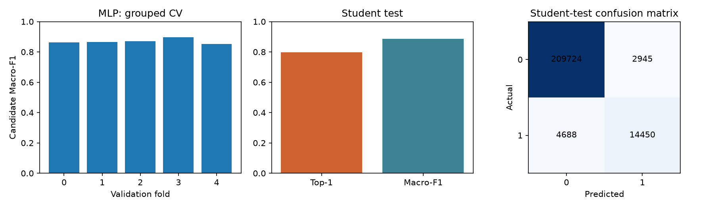

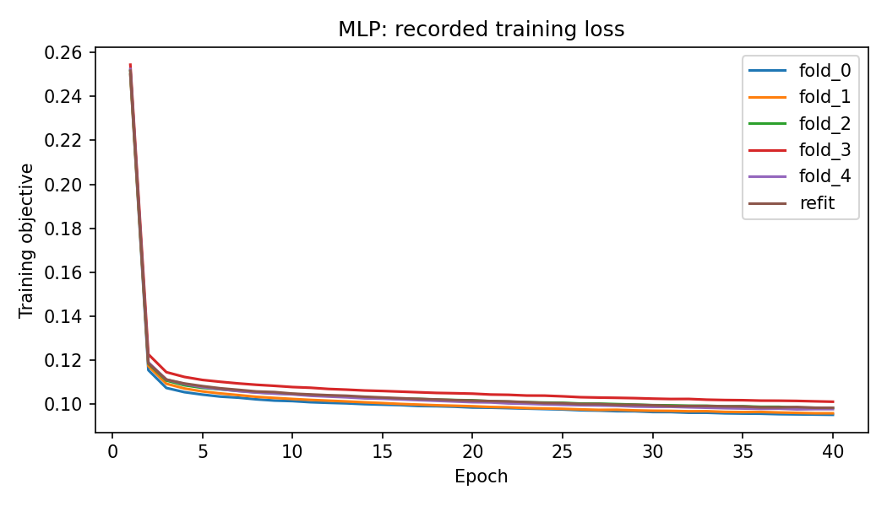


## 4. Bayesian hyperparameter optimisation

Tuning targeted **hist_gradient_boosting**, the measured baseline CV winner.
Optuna TPE used seed 42 with 10 completed trials:
3 startup trials and 7 subsequent
TPE proposals. Every completed objective evaluated all five full validation folds. Search fits
used approximately 250,000 known rows per fold, sampled
proportionally within every training trip/class. This is a fit budget, not a
validation subsample. The search winner then received full-row five-fold
confirmation before comparison with the full-row untuned baseline. No student-test result entered the objective.

Search distributions:

```json
{
  "max_iter": "CategoricalDistribution(choices=(60, 100, 160))",
  "learning_rate": "FloatDistribution(high=0.15, log=True, low=0.03, step=None)",
  "max_leaf_nodes": "CategoricalDistribution(choices=(15, 31, 63))",
  "min_samples_leaf": "CategoricalDistribution(choices=(20, 50, 100))",
  "l2_regularization": "FloatDistribution(high=10.0, log=True, low=0.01, step=None)"
}
```

Best trial: 3, objective Top-1
77.3094% under the search fit budget. Full-row confirmation
Top-1 was 77.3521%. Search compute was
264.1 s (sum of measured objective runtimes), plus
118.4 s for full-row confirmation.
The SQLite study and sampler state stay in the regenerable processed-data cache;
all trial parameters, objectives, timings and states are in
`results/metrics/tuning_trials.csv`, with per-trial fold metrics under
`results/metrics/member2/trial_*.json`.

Best parameters:

```json
{
  "max_iter": 160,
  "learning_rate": 0.14390269073091197,
  "max_leaf_nodes": 63,
  "min_samples_leaf": 50,
  "l2_regularization": 3.127814156703438
}
```

Tuned versus untuned, using identical metric definitions and partitions:

| model_name | cv_macro_f1 | cv_top1_accuracy | student_top1_accuracy | student_macro_f1 | student_log_loss | student_inference_time_sec |
| --- | --- | --- | --- | --- | --- | --- |
| hist_gradient_boosting_tuned | 0.8304 | 0.7735 | 0.8036 | 0.8360 | 0.1545 | 0.8489 |
| hist_gradient_boosting | 0.8236 | 0.7724 | 0.8041 | 0.8304 | 0.1651 | 0.4728 |

The raw tuned student Top-1 difference was -0.0470 percentage
points. This run did not show a student Top-1 gain from tuning, despite the CV improvement. The small differences do not establish statistical
superiority.

The tuned configuration replaced
the untuned baseline. The rule requires strictly better CV Top-1, regardless of
which row has a better student-test result. Tuned CV is optimistic after search;
student test provides the separate reported development check.

### Calibration and final export

A training-only audit fitted the selected base estimator on
48 trips, fitted a sigmoid on
16 disjoint trips, and evaluated probability
quality on 16 further disjoint trips. Its acceptance
rule requires a positive sigmoid slope, lower audit log loss and no higher audit
Brier score. This audit follows model selection and is not an unbiased estimate
of the entire selected pipeline. Student test never chooses calibration.

Audit raw/calibrated log loss: 0.133928 /
0.074208; Brier score:
0.039774 / 0.020706.
Calibration was **enabled**.
When enabled, the final sigmoid is fitted on known-label out-of-fold predictions
from all 80 training trips, then attached to the model refitted on all training
rows. Different base-fit sizes can shift probability distributions; held-out
student reliability is therefore reported, not assumed perfect.

Final exported student metrics: Top-1 80.3584%, Macro-F1
0.8892, log loss 0.082859, Brier
0.024220, ECE 0.004473, direct continuity
90.3812%. Sigmoid calibration is increasing and preserves
candidate score ordering apart from floating-point ties; it changes threshold
metrics and probability quality, not the intended route-ranking objective.

`models/model.joblib` accepts raw DataFrame features and includes fitted
preprocessing and optional calibration. `preprocessor.joblib` is separately saved
for inspection/reconstruction; do not apply it before calling the exported scorer.
The schema and card include seed, inputs, configuration/selection and artifact
checksums. Model outputs are finite probabilities for log-space decoding.
The inference scorer reads no reference files. See the handoff README for usage.

References checked 18 November 2026:
[HistGradientBoostingClassifier](https://scikit-learn.org/stable/modules/generated/sklearn.ensemble.HistGradientBoostingClassifier.html),
[Optuna TPESampler](https://optuna.readthedocs.io/en/stable/reference/samplers/generated/optuna.samplers.TPESampler.html),
[scikit-learn calibration](https://scikit-learn.org/stable/modules/calibration.html).

## 5. HMM/Viterbi route reconstruction

### Hidden states, emissions and transition weights

A state is a directed candidate arc at one GPS observation. IDs remain zero-based
rows of that trip's `.arcs` file. Candidate generation and the classifier retain
the frozen Member 1 schema and Member 2 final model. There is no global arc-ID
classifier and no reference-route input during prediction.

The calibrated classifier's positive probabilities are clipped away from zero,
normalised within each observation and logged. Per-observation normalisation is
a common factor across all paths and therefore does not change the Viterbi
argmax. These are discriminative emission potentials, not a claim that the
classifier learned a generative GPS likelihood.

Directed route distance includes the remaining fraction of the previous arc,
a shortest directed path from its end node to the next arc's start node, and
the travelled fraction of the next arc. On the same arc, forward progress uses
its direct along-arc distance; backward motion up to
20 m is treated as GPS jitter. Larger reverse
movement needs a directed loop. Parallel directed arcs are retained, not summed
into an inflated graph-matrix edge weight.

The transition log weight is `-|route_distance - GPS_displacement| / beta` for
reachable pairs and negative infinity for impossible pairs. These exponential
weights are not row-normalised empirical traffic transition probabilities.
The recurrence is a weighted HMM-style chain:

`delta[t,j] = log_emission[t,j] + max_i(delta[t-1,i] + log_transition[t,i,j])`.

Backpointers recover the globally best candidate chain within each continuous
segment. A shared score offset is subtracted at each step to keep arithmetic
stable; it preserves the path argmax. Candidate ordering makes score ties
choose lower arc IDs deterministically. Tests compare the recurrence with
exhaustive enumeration on a small chain.

This design follows the road-distance versus observed-displacement principle in
[Newson and Krumm (2009)](https://www.microsoft.com/en-us/research/publication/hidden-markov-map-matching-noise-sparseness/),
using our learned emissions, directed endpoint handling and explicit restart
rules. We do not claim to reproduce their experiment. No data was downloaded
from that paper; all runs used the organiser-provided development partitions.

### Missing candidates, gaps and disconnected roads

Actual feature generation supplies a nearest-arc fallback when the radius is
empty. The decoder additionally handles an empty observation by returning arc
`-1` and restarting afterwards. This sentinel is never used as a Python negative
network index. Actual student runs must still predict every observation.
Nonpositive time intervals, gaps above the selected threshold, spatial jumps
above 5000 m and chains with no feasible transition
start a new segment. Restart reasons are recorded. Impossible transitions do not
receive an invented road connection or straight connector geometry.

Dijkstra searches are bounded by GPS displacement plus
500 m, capped at 5000 m.
Source searches use 100 m cutoff buckets and an LRU cache; reconstructed paths
are checked against the exact cutoff. Routes outside this bounded search are
considered unavailable, not proven globally disconnected. A 16-candidate cap
limits dynamic-programming state size; all selected-candidate tables retain IDs.

### Decoder tuning and data separation

A separate scorer used 48 training trips for base
fitting, 16 disjoint trips for sigmoid
calibration, and 16 further training trips for decoder
tuning. All trip sets are recorded in `hmm_tuning_model.json`. This avoids tuning
on predictions from the final classifier fitted on all 80 trips. The base family
and parameters were selected earlier using training CV, so this is not independent
of all prior model selection and is not nested CV.

The grid used beta `[10,30,60,120]` m and restart gaps `[10,30,60]` s: twelve
configurations, with all observations from all sixteen tuning trips. Primary
selection was known-label micro point accuracy. Ties use direct continuity,
fewer restarts, larger beta, then a smaller restart gap. Student test did not
select parameters. Frozen settings are in `configs/hmm.json`:

```json
{
  "transition_beta_m": 10.0,
  "gap_restart_s": 30.0,
  "path_margin_m": 500.0,
  "max_route_distance_m": 5000.0,
  "backtrack_tolerance_m": 20.0,
  "candidate_cap": 16
}
```

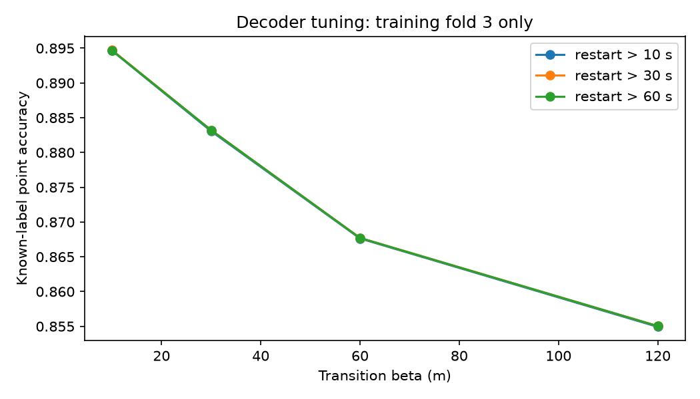

### Classifier-only versus decoding

Point accuracy compares every known observation label, including candidate
misses; unknown aligned labels are excluded and counted. Those labels are
approximate route-to-point supervision, not independently verified physical
truth. Distance/heading also influenced alignment, so high agreement has that
limitation. Reference-route imperfections remain documented in Member 1's EDA.

Direct continuity keeps B's definition: identical arcs or exact directed
head-to-tail adjacency between consecutive observation predictions. All points,
including unknown labels and time gaps, participate. This is intentionally
stricter than being connected by an intermediate road path.

Ordered sequence precision/recall use the longest common subsequence of arc
occurrences against the original reference `.route`; F1 is their harmonic mean.
Repeated arc IDs remain distinct ordered occurrences. This is neither a set
Jaccard score nor edit accuracy. Flattening restarted segments for LCS preserves
arc order but does not itself penalise a break; restart/segment counts and direct
continuity are therefore reported separately. Sequence endpoints may differ when
GPS covers only part of the supplied route.

The bridge-only control applies identical bounded path reconstruction to greedy
classifier choices. It leaves point labels unchanged and reveals how much sequence
improvement comes from inserting intermediate road arcs rather than Viterbi.

| partition | variant | n_known_obs | n_unknown_obs | pointwise_accuracy | route_continuity | sequence_precision | sequence_recall | sequence_f1 | decoder_restarts |
| --- | --- | --- | --- | --- | --- | --- | --- | --- | --- |
| decoder_tuning | classifier | 29420 | 2998 | 0.8100 | 0.9169 | 0.4474 | 0.8573 | 0.5880 | 0 |
| decoder_tuning | classifier_bridged | 29420 | 2998 | 0.8100 | 0.9169 | 0.2739 | 0.9765 | 0.4278 | 0 |
| decoder_tuning | hmm | 29420 | 2998 | 0.8947 | 0.9792 | 0.7019 | 0.9936 | 0.8227 | 6 |
| student_test | classifier | 19143 | 17 | 0.8036 | 0.9038 | 0.4223 | 0.8530 | 0.5649 | 0 |
| student_test | classifier_bridged | 19143 | 17 | 0.8036 | 0.9038 | 0.3023 | 0.9738 | 0.4614 | 0 |
| student_test | hmm | 19143 | 17 | 0.8846 | 0.9792 | 0.8355 | 0.9862 | 0.9046 | 5 |

On student test, classifier accuracy was 80.3584%; HMM
accuracy was 88.4605%. Direct continuity changed from
90.3812% to 97.9164%. Ordered route F1
was 0.5649 for raw classifier arcs,
0.4614 with bridging alone and 0.9046 with HMM
and bridging. Bridging alone increased ordered recall from 0.8530
to 0.9738, while precision fell from
0.4223 to 0.3023: filling paths
between noisy greedy choices adds many arcs outside the supplied ordered reference.
The HMM result therefore is not explained merely by adding intermediate arcs.
Tuning-set results are development scores after parameter selection,
not held-out performance estimates.

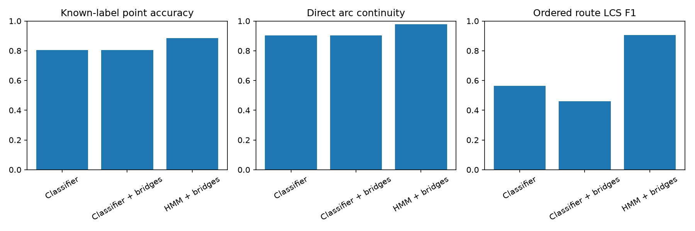

### Cases where HMM did not help

HMM had lower point accuracy than the classifier on 1 student trips.
The lowest per-trip changes were:

| trip_id | classifier | classifier_bridged | hmm | hmm_change |
| --- | --- | --- | --- | --- |
| 00000007 | 0.9106 | 0.9106 | 0.8486 | -0.0620 |
| 00000052 | 0.9275 | 0.9275 | 0.9618 | 0.0344 |
| 00000000 | 0.9253 | 0.9253 | 0.9596 | 0.0344 |

On the lowest-gain trip `00000007`, 93
known observations changed from classifier-correct to HMM-wrong, while
9 changed in the opposite direction.
This is a net loss of 84
correct labels. The offline failure screenshot focuses on one of the first group;
it is chosen after the decoder is frozen and does not influence tuning.

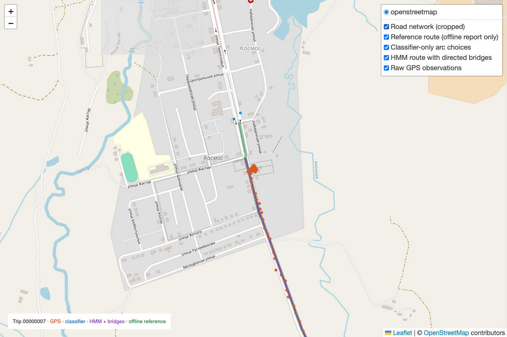

These cases must be interpreted alongside the measured changes, not hidden by
an aggregate. Hard topology constraints can favour a connected alternative when
candidate coverage, the road network, scorer probabilities or aligned labels are
wrong. A bounded search can also miss a longer valid detour. Per-trip rows, route
F1 and explicit restarts are in `hmm_comparison_by_trip.csv`; they do not establish
which input is physically correct in an ambiguous case.

### Latency and large trips

The largest student trip `00000056` has 3,958 points and
27,631 directed arcs. Its cold end-to-end inference took
1.906 s, including loading/projection, feature generation,
scoring, transition preparation, Viterbi and route expansion. With transitions
already prepared, Viterbi took 0.061 s. Model loading
is excluded when the batch reuses the startup scorer, as the future API should.
The provisional cold student target is 10 s, not an agreement invented with
Member 4. Maximum observed student cold time was 1.906 s.

The largest training trip `00000054` has
19,313 points. Its cold total was
5.053 s and warm Viterbi
0.282 s. It is used for speed only; its classifier
was fitted on training data, so its quality is not presented as generalisation.
A separate warm-graph cap-8 diagnostic is recorded but does not change the frozen
16-state configuration or student results. Detailed stages/cache counts are in
`decode_timing.csv`. Student cache counters include the later offline comparison
work, as labelled in `cache_scope`; the timed prediction stages exclude that work.

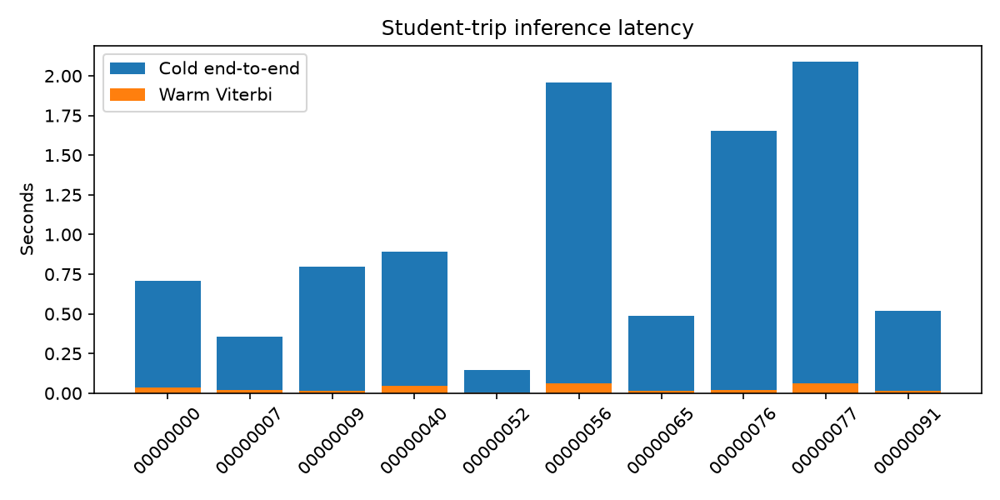

## 6. Geographical visualisation

All ten student maps are committed as `maps/pred_<trip_id>.html`. Layers include
raw GPS, cropped road geometry, classifier-only arc choices, HMM routes with
directed bridges, and the supplied reference route for the offline report only.
Colours, a legend, per-point tooltips, fitted bounds and layer controls distinguish
them. Predicted geometry consists of real road arcs; no straight road connector
is drawn across a restart. The generic map function adds a reference layer only
when explicitly supplied one by offline evaluation. API/UI inference must omit it.

Open [the largest student trip](../../maps/pred_00000056.html).
`src.visualization.render_maps` verifies all ten actual Folium pages and captures
the largest-trip and lowest-gain-trip views. The screenshot below is an actual
headless Chromium rendering with road layers, controls, legend and OpenStreetMap
tiles, not a manually fabricated map. Checks, browser version and focus observations
are in `folium_render_checks.json`. GPS display markers are subsampled to at most
700 per page; all observations still participate in decoding and evaluation.

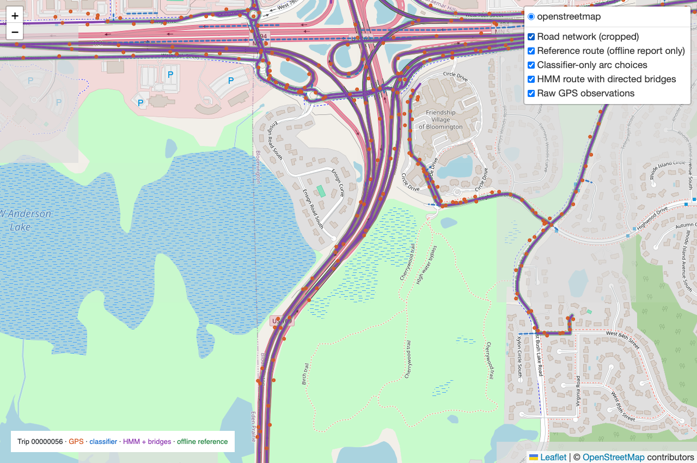


## 7. API, dashboard and deployment

### Two-laptop request flow

The model laptop hosts FastAPI on loopback port 8000 and Streamlit on port 8501. Cloudflared exposes only the dashboard. The second laptop opens its temporary HTTPS dashboard link. Streamlit executes API requests on the host, so raw files, models and reference routes remain there. This follows the latest requested deployment; it supersedes the original plan to run a UI server on Laptop 2.

`GET /health`, `/models` and `/trips` expose readiness, model selection evidence and permitted trip IDs. `POST /predict` is a synchronous compatibility interface. The UI uses `POST /jobs`, polls `/jobs/{id}`, then fetches `/jobs/{id}/result`. Only eight-digit permitted trip IDs and explicit model names are accepted; extra request fields are rejected. Public response schemas contain no reference IDs, aligned labels or reference geometry. No browser-to-API CORS exception is needed.

The final calibrated scorer and frozen HMM load at startup; other scorer artifacts load once on demand with schema checks. One worker serializes inference and bounds memory/CPU use. At most four jobs are outstanding and twelve jobs/results are retained. Jobs expire on eviction or server restart. Polling avoids a long in-flight tunnel request during KNN. The scorer owns its preprocessing and calibration, applied once.

`api/evaluation.py` is a separate post-inference boundary. It loads the reference, regenerates approximate alignment labels, and calls the Member 3 pointwise, sequence and direct-continuity metrics. Missing references leave valid predictions available with metrics marked unavailable. Log lines show trip ID, model, point count, server latency and classifier/HMM accuracy. Full errors stay in the host log.

### Model demonstration and interpretation

The dashboard offers KNN, MLP, Logistic Regression, Random Forest, baseline Histogram Boosting and the final tuned/calibrated Histogram Boosting. "Demo every model" runs them in that order and finishes with the selected configuration. Results accumulate in a per-trip table; the user can revisit each map, toggle HMM, inspect stage timings, and download prediction JSON. GPS observations, classifier arcs and HMM roads are distinct map layers. Each road arc is drawn separately so disconnected states never create fictitious straight road connectors. There is no live reference layer.

The best badge is based on highest mean training-fold observation Top-1. It is not recalculated from one displayed trip. The frozen decoder was tuned for the selected calibrated model; applying it to other classifiers is an interactive demonstration, not a separately optimized HMM comparison. Historical comparison rows are classifier-only; live per-trip metrics do not replace the full holdout study.

### Executed integration evidence

`results/metrics/integration_run.csv` records 15 successful real HTTP job results: all 10 student trips with the selected model and the five other configurations on the first trip. Every returned observation has a valid predicted arc. Selected-model server time (including fresh reference alignment and response construction, excluding queue wait) ranged from 167.41 to 2686.56 ms. HTTP wall time includes polling and JSON transfer and is recorded separately. The first-trip KNN request took 14.04 s. This is measured API latency, not a claim about other hardware or network conditions.

| trip_id | model | n_observations | server_ms | classifier_accuracy | hmm_accuracy |
| --- | --- | --- | --- | --- | --- |
| 00000000 | best | 2503 | 943.4254 | 0.9253 | 0.9596 |
| 00000007 | best | 1354 | 455.4157 | 0.9106 | 0.8486 |
| 00000009 | best | 1049 | 933.7073 | 0.7588 | 0.8484 |
| 00000040 | best | 2995 | 1136.5665 | 0.8684 | 0.9339 |
| 00000052 | best | 262 | 167.4112 | 0.9275 | 0.9618 |
| 00000056 | best | 3958 | 2686.5565 | 0.8325 | 0.9224 |
| 00000065 | best | 768 | 560.3243 | 0.7891 | 0.9010 |
| 00000076 | best | 1486 | 1813.1708 | 0.7779 | 0.8957 |
| 00000077 | best | 3911 | 1994.0727 | 0.6295 | 0.7709 |
| 00000091 | best | 874 | 613.5453 | 0.7883 | 0.8822 |
| 00000000 | knn | 2503 | 14039.2069 | 0.9081 | 0.9449 |
| 00000000 | mlp | 2503 | 988.7276 | 0.9229 | 0.9573 |
| 00000000 | logistic_regression | 2503 | 817.6751 | 0.9129 | 0.9640 |
| 00000000 | random_forest | 2503 | 1070.9767 | 0.9249 | 0.9636 |
| 00000000 | hist_gradient_boosting | 2503 | 873.8235 | 0.9241 | 0.9628 |

`ui_integration.json` records 16 successful real-browser checks, covering ten student trips, the batch model demo, switching among six completed results and the HMM toggle. Browser JavaScript errors: 0. The following screenshots show the actual local dashboard; they are not evidence of a physical second laptop.

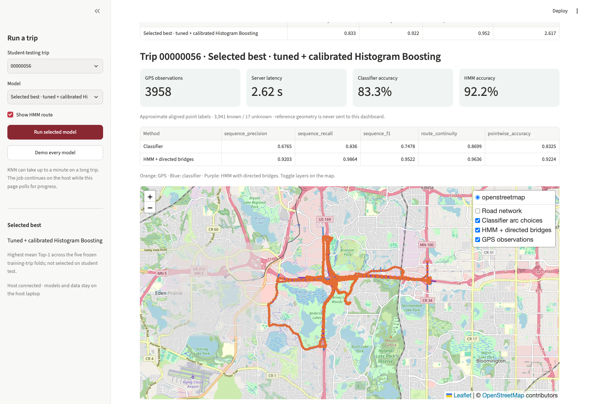

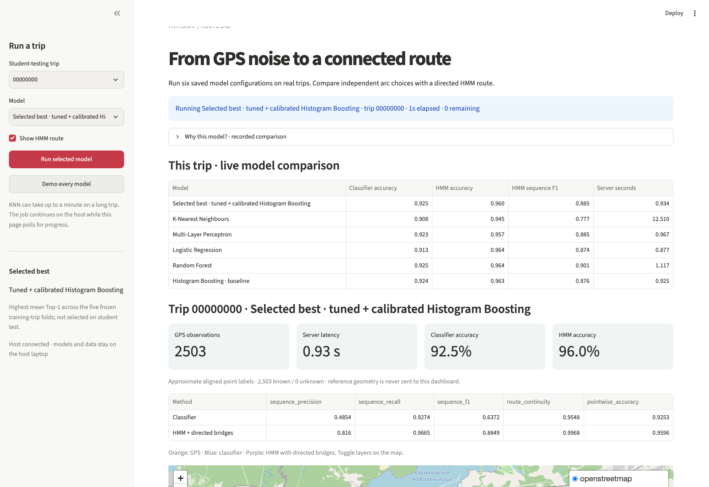

Repository check: 0 findings from tracked raw-data/environment checks, common credential patterns, and a 95 MB file guard. Largest tracked file: models/member1/knn/model.joblib (75,667,729 bytes). This pattern scan is not a guarantee of secret detection. Evidence: `repo_hygiene.json`.

### Commands, connectivity and remaining external check

All commands are in `scripts/README.md`. `scripts/setup.sh` installs exact direct dependency versions for Python 3.13. `scripts/host.sh` starts API, UI and the temporary dashboard tunnel and stops its children on Ctrl-C. Separate-terminal commands are `serve.sh api`, `serve.sh ui`, and `tunnel.sh`. The receiving laptop may run `check-dashboard.sh HTTPS_URL` or curl `HTTPS_URL/_stcore/health`, then open the URL and run a prediction while the host log is visible.

Public tunnel verification remains blocked in this development environment: cloudflared 2026.11.1 and a direct HTTPS check both received connection resets from `api.trycloudflare.com` before a tunnel URL could be created. No working public URL, remote terminal screenshot or physical second-laptop success is claimed. Repeat the connectivity check on the actual demo network and capture the receiving browser plus host log. Quick Tunnels are temporary testing links and change URL on restart.

Fallback: place both laptops on the same Wi-Fi/hotspot, run `UI_HOST=0.0.0.0 scripts/host.sh --local`, allow inbound dashboard port 8501, and open `http://HOST_LAN_IP:8501` on Laptop 2. API remains local. If QUIC connectivity fails after tunnel creation, `TUNNEL_PROTOCOL=http2 scripts/tunnel.sh` is available. If Internet tiles fail, prediction geometry/metrics still work over LAN; do not present saved screenshots as live inference.

## 8. Findings and limitations

The selected calibrated classifier and directed HMM improve aggregate student-test point accuracy and route quality, while retaining a visible failure case. Candidate misses, imperfect label alignment, bounded route searches, long gaps and model probability quality remain limits. Model selection is a training-CV decision; the very small baseline CV lead and slight tuned student Top-1 decline are disclosed in section 4. This demonstration does not establish performance on unseen regions, evaluator-test data, production traffic or a network not tested here.

The shipped scripts reproduce model/API/UI checks and assemble this report. Source tables, plots and experiment logs remain in the repository; raw and regenerable processed data remain local. `results/metrics/report_manifest.json` records SHA-256 values for report inputs and evidence. A physical two-laptop run is the remaining deployment acceptance step.

## 9. References and evidence index

- Newson and Krumm (2009), Hidden Markov Map Matching Through Noise and Sparseness. https://www.microsoft.com/en-us/research/publication/hidden-markov-map-matching-noise-sparseness/
- Cloudflare Quick Tunnels: https://developers.cloudflare.com/tunnel/get-started/quick-tunnels/
- Streamlit deployment/configuration: https://docs.streamlit.io/develop/api-reference/configuration/config.toml
- Data and feature evidence: `inventory.csv`, `quality_report.csv`, `label_alignment.csv`, `candidate_sweep.csv`, `data_manifest.csv`.
- Classifier evidence: `model_comparison.csv`, `tuned_vs_untuned.csv`, `tuning_trials.csv`, `calibration_audit.json`, `final_export_metrics.csv`, model cards and experiment logs.
- Decoder evidence: `hmm_tuning.csv`, `hmm_comparison.csv`, per-trip comparison, `decode_timing.csv`, `folium_render_checks.json` and frozen `configs/hmm.json`.
- Deployment evidence: `integration_run.csv`, `ui_integration.json`, `report/figures/`, concise `DECISIONS.md`, and reproducible commands in `scripts/README.md`.
