# Member 1 report source: EDA, KNN and MLP

This is section 2.2 and the two Member 1 model subsections for Member 4 to merge
into the single consolidated PDF. It is generated by
`python -m src.data_processing.member1_report` from measured local run outputs.
Code, report prose and analysis were prepared with Codex AI assistance. The team
must review the analysis and be able to reproduce and explain the results.
No evaluator-test data was accessed.

## 2.2 Dataset understanding and exploratory analysis

### Preprocessing and partition inventory

Strict loaders validate the documented headerless whitespace files: track
longitude/latitude/time, node longitude/latitude, directed arc node IDs and an
ordered route of arc IDs. All IDs are zero-based file-row numbers local to a trip.
There is no row-to-row correspondence between track and route. Raw data and
regenerable tables stay local. File-by-file sizes, row counts and dtypes are in
`results/metrics/inventory.csv`; SHA-256 inputs are in `data_manifest.csv`.

| partition | trips | observations | min_observations | median_observations | max_observations | nodes | arcs | missing_values | large_gaps | broken_route_links |
| --- | --- | --- | --- | --- | --- | --- | --- | --- | --- | --- |
| student_test | 10 | 19160 | 262 | 1420.0000 | 3958 | 90689 | 185041 | 0 | 44 | 1 |
| train | 80 | 208417 | 361 | 1529.0000 | 19313 | 1933485 | 3876904 | 0 | 1216 | 13 |

Only train and student-test partitions appear in this analysis. Timestamps and
GPS observations are preserved in original order, without silent imputation or
resampling. There are 0 duplicate and
0 decreasing timestamp steps across these
validated development trips. Gaps greater than 5 s are flagged for downstream
sequence handling. Actual interval frequencies, rather than averages of trip
percentages, give this point-weighted sampling summary:

| partition | intervals | one_second_share | maximum_gap_s |
| --- | --- | --- | --- |
| student_test | 19150.0000 | 0.9862 | 210.0000 |
| train | 208337.0000 | 0.9650 | 153064.0000 |

The largest training interval is 153,064 s
(42.5 hours), versus
210 s in student test. A displacement-derived speed across a large gap is an interval
average, not a reliable instantaneous vehicle speed. The gap flag is available
to the decoder; no points are deleted to hide these interruptions.

Directed graph diagnostics include weak and strong components, isolated nodes,
reverse-arc share and zero-length arcs for every trip in `quality_report.csv`.
The reference route contains 14 head-to-tail breaks
across development trips. These are supplied reference limitations; the loader
does not insert artificial road connections.

### Geometry, features and why they were chosen

Each trip uses a local azimuthal equidistant projection centred on mean latitude
and circular-mean longitude, in metres with explicit longitude/latitude ordering.
This accommodates trips in different regions and avoids comparing degrees as
Euclidean metres. Exact CRS strings are saved per trip. Up to 1,000 evenly
spaced road arcs per trip were compared with WGS84 geodesic length; maximum
sampled relative discrepancy across development trips was
0.000668%. This checks these networks,
not arbitrary long-distance extrapolation.

The twelve input features are GPS-to-segment distance, projected fraction along
the arc, heading disagreement, heading validity, speed, arc length, distance rank,
start-node incoming degree, end-node outgoing degree, time gap, large-gap flag and
outside-radius fallback flag. Distance anchors proximity; heading separates
opposite directions; fraction/length/rank describe local geometry; degrees expose
junction context; speed/gaps indicate motion and temporal reliability. Invalid
headings carry a validity flag. Only the training fold fits the scaler.
IDs, reference route positions, labels and partition names are never model inputs.
Full definitions and units are in `report/member1/README.md`.

### Observation-label alignment and its limits

The supplied reference is an ordered arc sequence, not a label per GPS row.
An offline dynamic program aligns observations to route occurrences in
nondecreasing order, permitting skipped short arcs and repeated arc IDs. Its
cost is point-to-segment distance plus a fixed 15 m heading disagreement term
`15*(1-cos(delta))` when movement supplies a valid heading. Start/end route
positions are unconstrained. Assignments farther than 100 m are unknown.

| partition | n_obs | unknown_labels | skipped_route_occurrences |
| --- | --- | --- | --- |
| student_test | 19160 | 17 | 387 |
| train | 208417 | 20540 | 3048 |

Unknown labels are stored as `ref_arc=-1` / `is_ref=-1` and excluded from fitting
and candidate classification metrics; they are never silently negative examples.
Nearest-reference diagnostics independently show whether errors come from route
ordering or from the GPS being far from the entire supplied route:

| partition | trip_id | nearest_reference_median_m | nearest_reference_over100m |
| --- | --- | --- | --- |
| train | 00000054 | 138.6163 | 16157 |
| train | 00000033 | 122.4213 | 2978 |
| train | 00000002 | 5.6746 | 719 |
| train | 00000043 | 10.9876 | 60 |
| train | 00000019 | 5.5098 | 21 |

These measurements support an offset/reference mismatch in the largest outliers;
they do not establish which input is physically correct. Alignment can remain
ambiguous around parallel roads, junctions, loops, gaps, and broken reference
links. Progress within one arc occurrence is not constrained. Features also
include distance and heading, so pointwise model scores partly measure agreement
with this surrogate alignment. Unknown exclusions change the evaluated population.
Original-route sequence metrics remain necessary in Member 3's evaluation.

### Candidate selection and error ceiling

An STRtree indexes complete arc segments. Search includes arcs within a metric
radius, sorts by exact segment distance then arc ID, and caps candidates at K.
If the radius is empty, the nearest segment is returned without consulting labels.
The full training-only sweep is:

| radius_m | k | candidate_miss_rate | mean_candidates |
| --- | --- | --- | --- |
| 25 | 4 | 0.0474 | 3.0252 |
| 25 | 8 | 0.0261 | 4.0035 |
| 25 | 16 | 0.0227 | 4.5030 |
| 50 | 4 | 0.0420 | 3.4375 |
| 50 | 8 | 0.0181 | 5.3971 |
| 50 | 16 | 0.0136 | 7.4462 |
| 100 | 4 | 0.0408 | 3.6926 |
| 100 | 8 | 0.0149 | 6.5337 |
| 100 | 16 | 0.0095 | 10.8602 |

The fixed policy selects the smallest mean candidate count with <=1% known-label
miss rate, otherwise the lowest miss rate. It selected 100 m /
K=16, with 0.9543% known-label misses and
10.860 candidates per observation. The corresponding
known-label training Top-1 ceiling is 99.0457%.
Student-test labels did not choose this configuration. The sweep uses all
training trips before model CV; model CV is conditional on that frozen candidate
configuration, not a nested unbiased estimate of candidate-parameter selection.

### Visual evidence

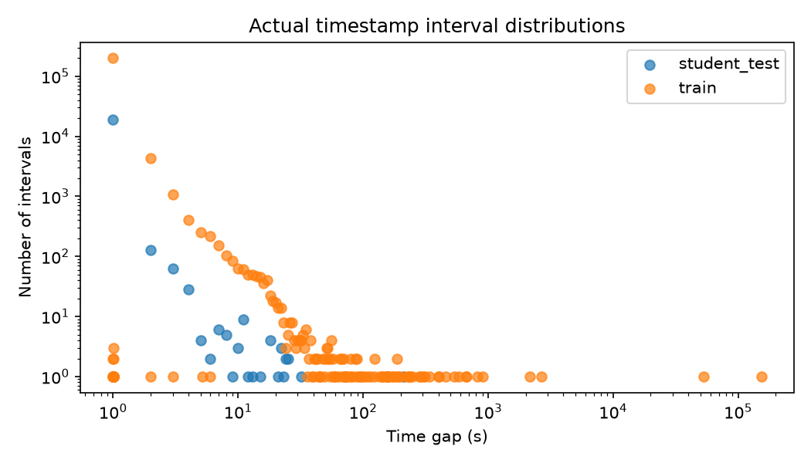
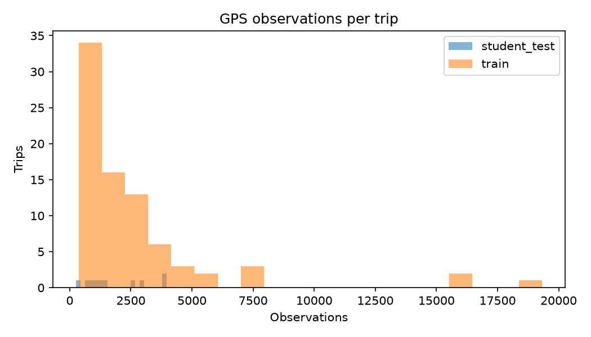
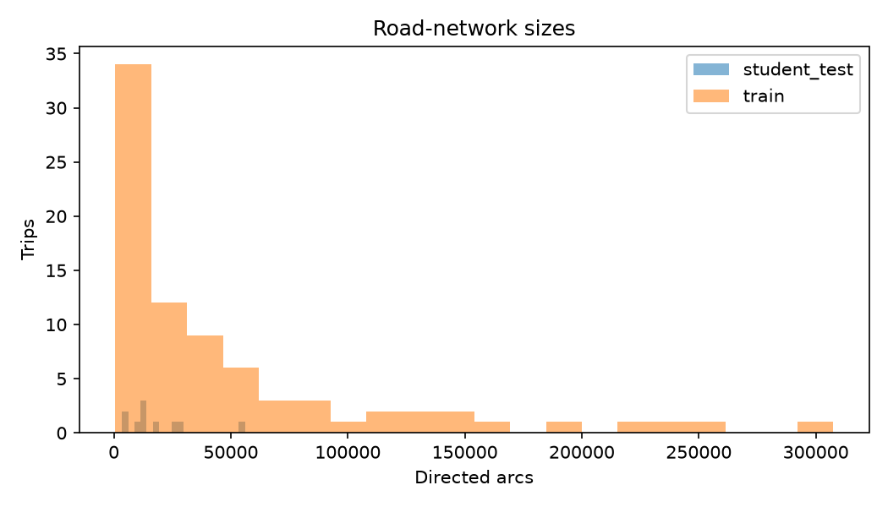
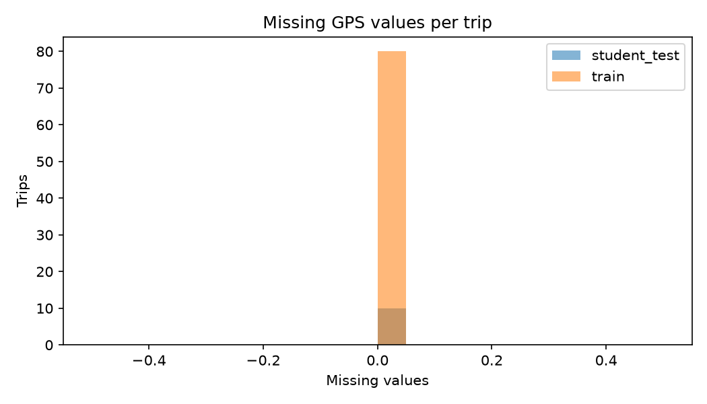
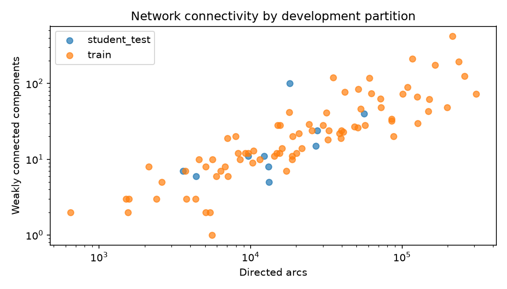
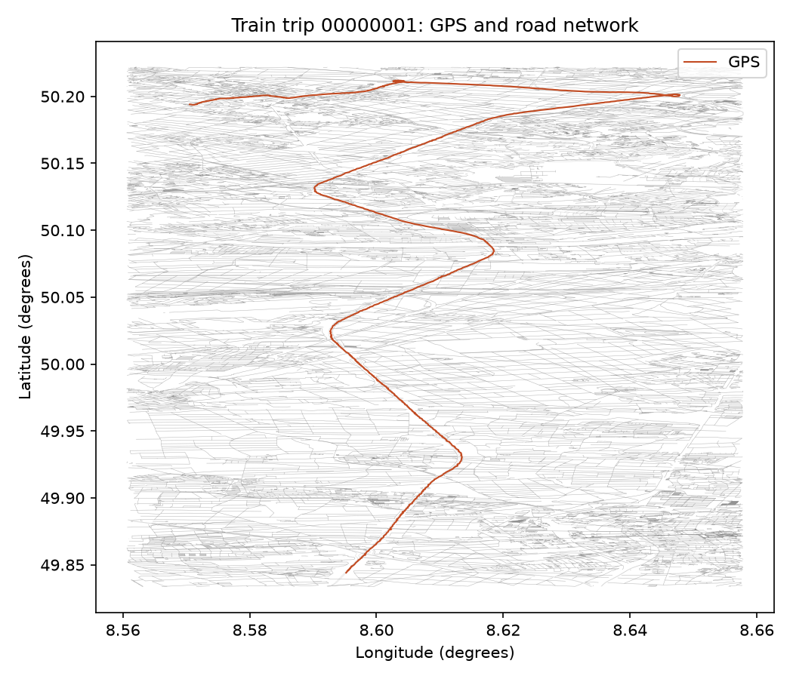
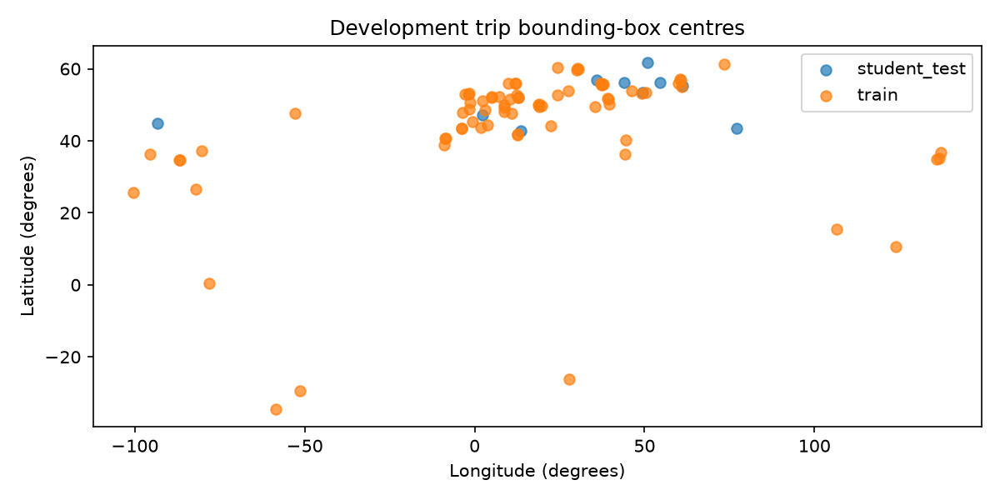
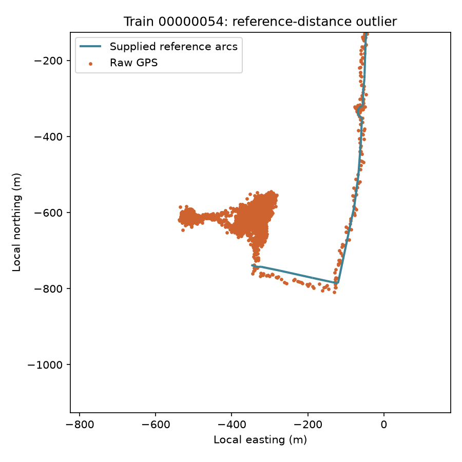
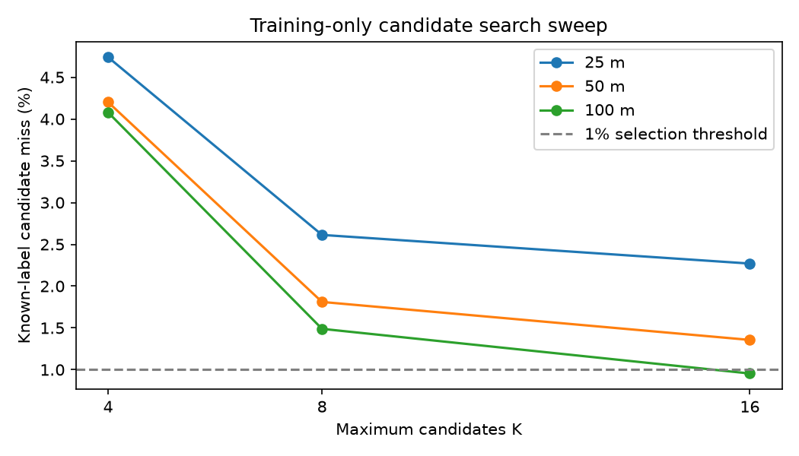

The train-only interactive GPS/network map is
[`maps/eda_train_00000001.html`](../../maps/eda_train_00000001.html), with separate
layers, extent and legend. `notebooks/01_eda.ipynb` reads the inventory and diagnostic
outputs. Member 3 adds reference and prediction layers for decoder comparisons.

## 3. Member 1 model experiments

Both models use the same frozen feature order and seeded five-fold GroupKFold
assignments over 80 trips. The student-test partition contains 10 disjoint trips.
All validation observations from a trip stay outside that fold's fitting and
scaling. Unknown labels are excluded. Candidate-level binary Macro-F1 gives both
classes equal weight; Top-1 selects the highest positive score per observation
and includes candidate misses in its known-label denominator. Tied scores choose
the lower arc ID. Both point-weighted and trip-mean Top-1 are retained in logs.

The scorer returns one binary probability per candidate. These are uncalibrated;
calibration and HMM emission treatment require Member 2/3 evaluation. These two
runs do not select the team's final model or satisfy the five-model minimum by
themselves. C1's route-continuity metric is pending, shown as N/A explicitly.

| model | family | cv_macro_f1 | cv_macro_f1_std | student_top1 | route_continuity | student_macro_f1 | log_loss | inference_time_s |
| --- | --- | --- | --- | --- | --- | --- | --- | --- |
| KNN | Instance-based | 0.8599 | 0.0148 | 0.7874 | N/A: C1 not yet delivered | 0.8788 | 0.2455 | 153.1670 |
| MLP | Neural network | 0.8694 | 0.0167 | 0.7969 | N/A: C1 not yet delivered | 0.8866 | 0.0834 | 0.0306 |

Within these two measured configurations, MLP had the higher
student-test Top-1 (79.6949%), while MLP had the
shorter student inference time (0.031 s). These are
observations from the recorded run, not statistical significance claims or final
team-model selection. The KNN fit-sample score includes self-neighbours; the MLP
convergence record must be checked alongside its held-out metrics.

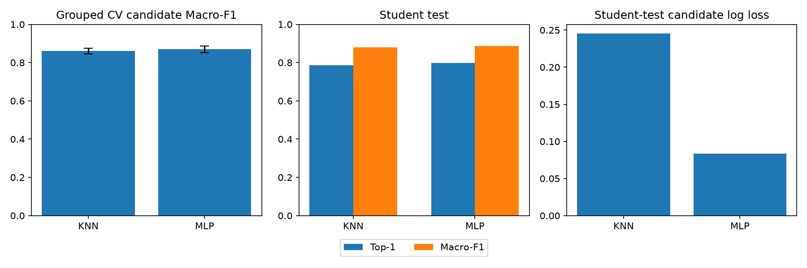

### 3.2 KNN

1. **Suitability.** Nearby candidate feature patterns can vote for correct-road likelihood without a linear decision boundary.
2. **Strengths and limitations.** Distance weighting adapts locally with no iterative fitting, but irrelevant/scaled dimensions, class imbalance, stored training data and expensive neighbour queries are limitations.
3. **Inputs.** The same twelve schema features above; identifiers and labels are excluded.
4. **Preprocessing and split.** StandardScaler fits only on this fold's known-label training rows. Five grouped folds share no trips. The final refit used 2,134,559 rows from 80 trips; configured sample cap was 0 (0 means all known rows).
5. **Initial hyperparameters.** The exact configuration below was run; no Member 1 Bayesian tuning or final team model selection is claimed.
6. **Objective.** There is no gradient-trained loss: fitting stores examples and a KD-tree. Positive probability is a distance-weighted neighbour vote. No epoch loss curve exists.
7. **Student-test performance.** Candidate accuracy 96.4186%, positive precision 0.7991, recall 0.7563, F1 0.7771. Known observations 19,143; unknown observations excluded 17; candidate miss rate 0.0261%.
8. **Required comparison metrics.** Student Top-1 78.7390%, candidate Macro-F1 0.8788, log loss 0.2455; CV candidate Macro-F1 0.8599 ± 0.0148 (sample standard deviation across five folds). Model-only refit time (excluding scaler fitting) 1.590 s; student inference time 153.167 s for 231,905 candidate rows, excluding raw-data loading, features and decoding.
9. **Fit/generalisation evidence.** The diagnostic exceeds grouped CV by 0.1401; this is consistent with memorisation or overfitting to fitted examples, with the self-neighbour caveat for KNN. The <=10k fit-sample diagnostic Macro-F1 was 1.0000, versus held-out fold range 0.8465–0.8843.  This diagnostic includes KNN self-neighbours and is optimistic. It is not independent evidence of generalisation. The fold spread and student results are the appropriate measured checks. Refit warnings: none.

```json
{
  "algorithm": "kd_tree",
  "leaf_size": 40,
  "metric": "minkowski",
  "metric_params": null,
  "n_jobs": 2,
  "n_neighbors": 15,
  "p": 2,
  "weights": "distance"
}
```

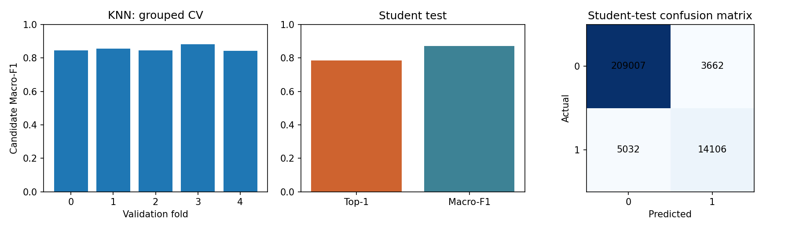

### 3.2 MLP

1. **Suitability.** A compact nonlinear network can combine proximity, direction and junction features into candidate probabilities.
2. **Strengths and limitations.** The compact network learns nonlinear combinations and has batched inference, but requires scaling, iterative optimisation and regularisation; the recorded convergence warnings must be considered.
3. **Inputs.** The same twelve schema features above; identifiers and labels are excluded.
4. **Preprocessing and split.** StandardScaler fits only on this fold's known-label training rows. Five grouped folds share no trips. The final refit used 2,134,559 rows from 80 trips; configured sample cap was 0 (0 means all known rows).
5. **Initial hyperparameters.** The exact configuration below was run; no Member 1 Bayesian tuning or final team model selection is claimed.
6. **Objective.** Adam minimises binary cross-entropy with L2 regularisation (alpha=0.001). No random observation-level internal validation split is used. The retained loss curve is the actual training objective, not validation loss.
7. **Student-test performance.** Candidate accuracy 96.7072%, positive precision 0.8307, recall 0.7550, F1 0.7911. Known observations 19,143; unknown observations excluded 17; candidate miss rate 0.0261%.
8. **Required comparison metrics.** Student Top-1 79.6949%, candidate Macro-F1 0.8866, log loss 0.0834; CV candidate Macro-F1 0.8694 ± 0.0167 (sample standard deviation across five folds). Model-only refit time (excluding scaler fitting) 76.161 s; student inference time 0.031 s for 231,905 candidate rows, excluding raw-data loading, features and decoding.
9. **Fit/generalisation evidence.** The diagnostic-to-CV gap is 0.0123; these measurements do not show a large fitting gap at this configuration. They do not establish that optimisation has converged or rule out underfitting. The <=10k fit-sample diagnostic Macro-F1 was 0.8817, versus held-out fold range 0.8536–0.8973.  This diagnostic uses fitted examples and is optimistic. It is not independent evidence of generalisation. The fold spread and student results are the appropriate measured checks. Refit warnings: ["Stochastic Optimizer: Maximum iterations (40) reached and the optimization hasn't converged yet."]. A warning at the epoch limit means convergence was not established; lower training loss alone does not establish better held-out route matching.

```json
{
  "activation": "relu",
  "alpha": 0.001,
  "batch_size": 512,
  "beta_1": 0.9,
  "beta_2": 0.999,
  "early_stopping": false,
  "epsilon": 1e-08,
  "hidden_layer_sizes": [
    32,
    16
  ],
  "learning_rate": "constant",
  "learning_rate_init": 0.001,
  "max_fun": 15000,
  "max_iter": 40,
  "momentum": 0.9,
  "n_iter_no_change": 8,
  "nesterovs_momentum": true,
  "power_t": 0.5,
  "random_state": 42,
  "shuffle": true,
  "solver": "adam",
  "tol": 0.0001,
  "validation_fraction": 0.1,
  "verbose": false,
  "warm_start": false
}
```

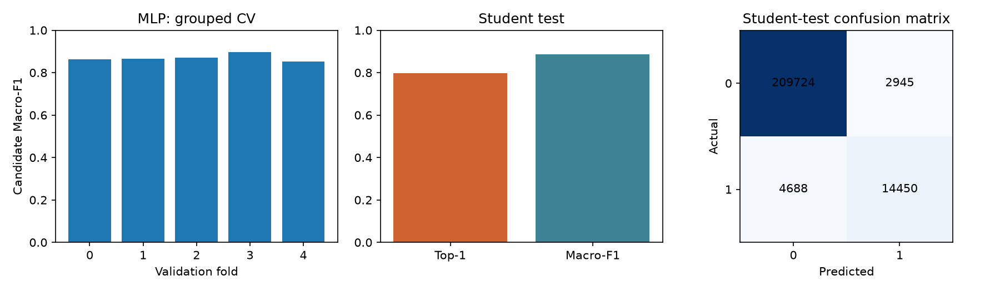

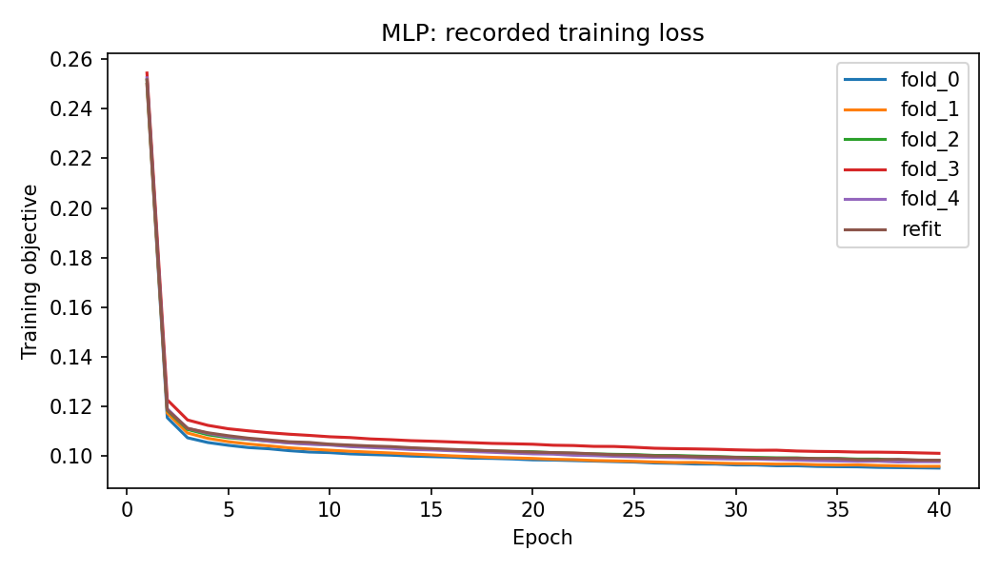

## Reproducibility, handoff and scope

`results/metrics/{knn,mlp}_experiments.{csv,json}` contains every fold, timing,
fit count, confusion matrix and warning. MLP's recorded loss is in
`mlp_loss_history.csv`; model cards include configuration, seeds, input hashes,
sampling policy, diagnostics and limitations. The two portable model artifacts
live under `models/member1/`; they do not overwrite Member 2's final model.
See `README.md` in this directory for commands and exact contracts.

The interim Member 1 harness uses B's planned folds and metrics while B1 is absent.
Member 2 can reuse it or independently verify the two rows in its shared harness.
Route continuity, sequence metrics, the HMM, three other algorithms, Bayesian
optimisation, API/UI and final consolidated PDF are other workstreams' tasks.
These results cover Member 1 only. Team review and viva preparation are still
required; no downstream integration or final submission is claimed.

Official implementation references (retrieved 18 November 2026):
[Shapely STRtree](https://shapely.readthedocs.io/en/stable/strtree.html),
[scikit-learn GroupKFold](https://scikit-learn.org/stable/modules/generated/sklearn.model_selection.GroupKFold.html),
[scikit-learn MLPClassifier](https://scikit-learn.org/stable/modules/generated/sklearn.neural_network.MLPClassifier.html).
