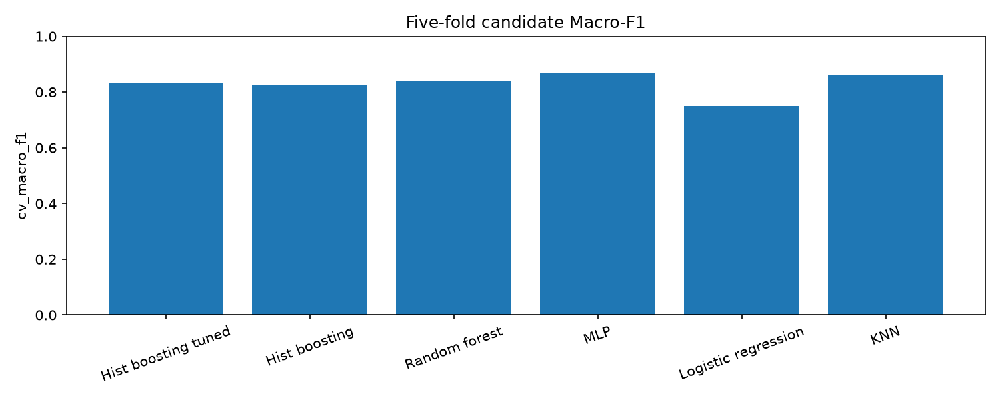
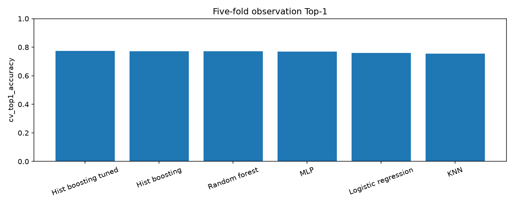
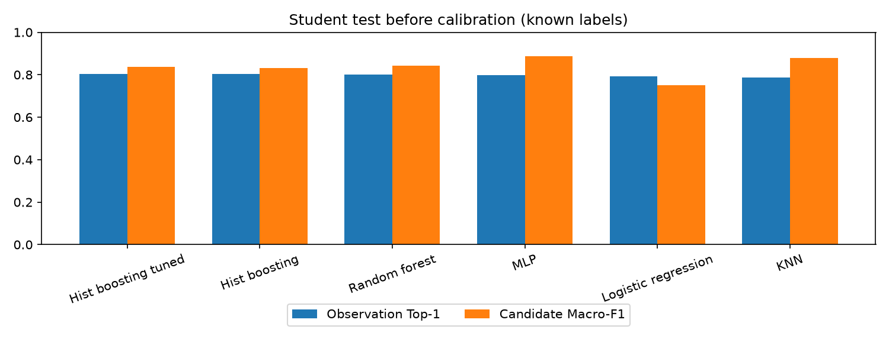
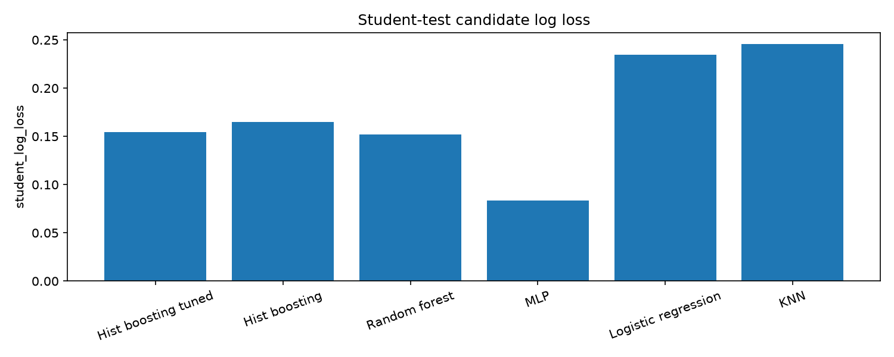
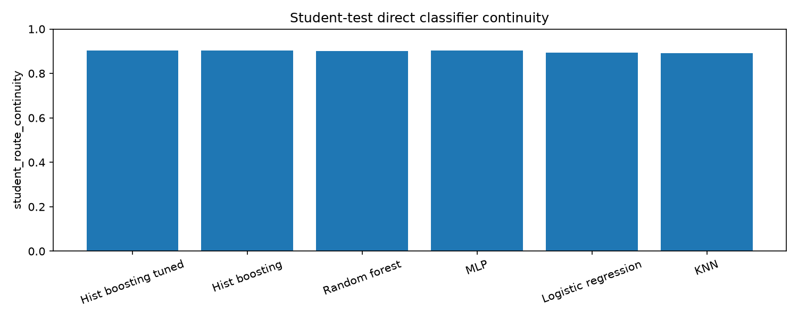
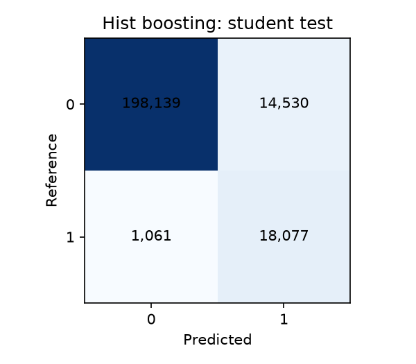
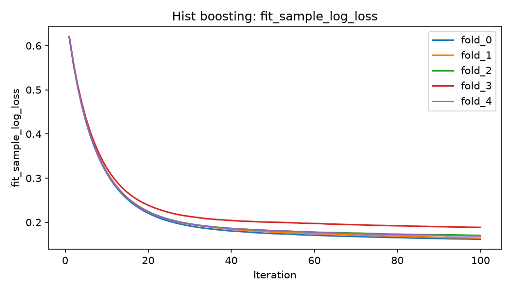
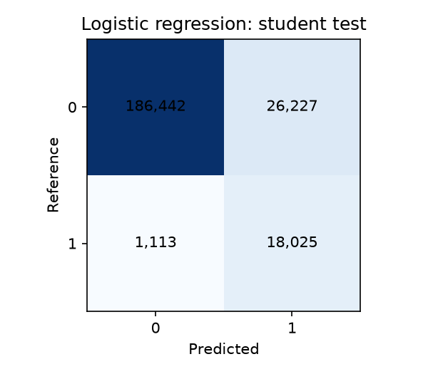
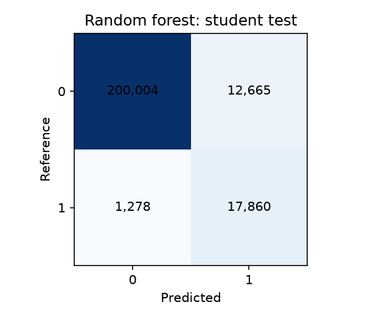
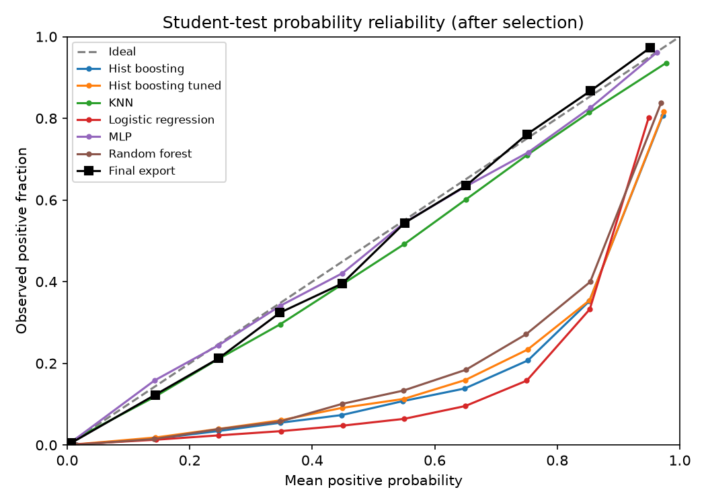

# Member 2 report source: model comparison, experiments and tuning

These sections extend Member 1's report source for the single final team PDF.
All values are from local executed runs. Code and report drafting used Codex AI
assistance; the team remains responsible for understanding and verifying them.
No evaluator-test partition was read.

## 3.1 Consolidated comparison and selection

The five distinct families are Logistic Regression, KNN, Random Forest,
histogram gradient boosting and MLP. A tuned variant is a separate row, not a
sixth distinct baseline family. All use the same schema and frozen five trip
folds over the 80 training trips. Known-label training rows total 2,134,559;
20,540 training and 17 student-test observations have unknown alignment labels.
`-1` never enters supervised fitting or candidate metrics. Top-1 counts missing
reference candidates as incorrect and excludes only unknown reference labels.

The comparison rows below are **before post-selection sigmoid calibration**.
Final exported metrics are reported in section 4 and `final_export_metrics.csv`.

| Model | CV Macro-F1 | CV Top-1 | Student Top-1 | Direct continuity | Student Macro-F1 | Log loss | Inference (s) |
| --- | --- | --- | --- | --- | --- | --- | --- |
| hist_gradient_boosting_tuned | 0.8304 | 0.7735 | 0.8036 | 0.9038 | 0.8360 | 0.1545 | 0.8489 |
| hist_gradient_boosting | 0.8236 | 0.7724 | 0.8041 | 0.9030 | 0.8304 | 0.1651 | 0.4728 |
| random_forest | 0.8373 | 0.7724 | 0.8010 | 0.9017 | 0.8428 | 0.1519 | 0.8056 |
| mlp | 0.8694 | 0.7703 | 0.7969 | 0.9023 | 0.8866 | 0.0834 | 0.0436 |
| logistic_regression | 0.7507 | 0.7607 | 0.7926 | 0.8940 | 0.7502 | 0.2345 | 0.0072 |
| knn | 0.8599 | 0.7539 | 0.7874 | 0.8909 | 0.8788 | 0.2455 | 150.0669 |

The primary metric is mean fold observation Top-1: one candidate road arc must be
chosen per GPS observation. Candidate Macro-F1 measures performance despite many
negative rows; log loss, Brier score and reliability diagrams assess probability
quality for the decoder. Exact score ties choose the lower arc ID. Preprocessing
is fitted on known-label rows within each training fold only.

The measured baseline CV winner was **hist_gradient_boosting**.
The final family/configuration is **hist_gradient_boosting_tuned**.
Only CV scores choose the family and tuned-versus-untuned configuration; student
test is a reported development holdout, not an optimisation objective. Family
and search selection reuse CV, so these CV values are selection-optimistic, not
nested-CV estimates. Candidate radius/K was already chosen using training-wide
labels; CV remains conditional on that fixed candidate configuration.

Member 1 KNN/MLP results were reused after checking data, schema, folds and source
fingerprints. Their historical CV probabilities were not retained, so their CV
Brier/ECE/continuity remain unavailable. Their saved full-training models were
run on student test to measure those diagnostics consistently for all models.
No absent metric was fabricated or inferred from a confusion matrix.

Route continuity here is a classifier-only B diagnostic: adjacent observation
predictions use the same directed arc or connect head-to-tail. Unknown labels and
large gaps remain in this topology-only metric. Missing observation indexes break
continuity. Short intermediate road arcs can be skipped between GPS observations,
so this direct metric does not establish physical route infeasibility. C1's final
metric, HMM transitions and sequence evaluation remain Member 3's work.







## 3.2 Member 2 model subsections

Member 1's KNN and MLP nine-question sections remain in
`report/member1/eda_and_models.md`. Below are the three additional families.

### Hist boosting

1. **Suitability.** Histogram boosting can learn nonlinear feature combinations with efficient tabular-data fitting.
2. **Strengths and limitations.** Sequential tree corrections are expressive and compact. Learning rate, leaf count and iteration count control capacity. Row-level early stopping is disabled to keep trips out of internal mixed partitions.
3. **Inputs.** The twelve frozen geometry/motion/connectivity features. Trip IDs, observation indexes, arc IDs, reference routes and labels are excluded from learned inputs.
4. **Preprocessing and validation.** Logistic Regression uses a fold-fitted StandardScaler; tree families use raw features. Five trip-grouped folds hold out 16 trips each; no row-level split mixes trips. Final refit used 2,134,559 known candidate rows from 80 trips.
5. **Initial configuration.** Exact recorded parameters follow below. The Random Forest's bootstrap fraction limits rows per tree, not the set of training trips admitted to the fit.
6. **Objective.** Weighted binary log loss with L2 leaf regularisation; histogram-based gradient boosting.
7. **Student-test results.** Candidate accuracy 93.2741%, positive precision 0.5544, recall 0.9446, F1 0.6987; known observations 19,143, unknown observations 17; candidate miss rate 0.0261%.
8. **Required metrics.** Student Top-1 80.4054%, Macro-F1 0.8304, log loss 0.1651. CV Macro-F1 0.8236 (fold SD 0.0104); CV Top-1 77.2413%. Refit 17.399 s; student inference 0.473 s for 231,905 candidate rows. Timings exclude loading, feature generation and HMM decoding.
9. **Fit/generalisation evidence.** This diagnostic/CV gap does not show strong overfitting at this configuration; it does not rule out underfitting or probability-threshold effects. The <=10k fitted-row diagnostic Macro-F1 was 0.8360, a +0.0124 difference from grouped CV. It is optimistic because these rows entered fitting. Fold Macro-F1 ranged 0.8172–0.8420. This measured gap and fold spread guide overfitting assessment; training score alone cannot establish generalisation or rule out underfitting. Refit warnings: none.

```json
{
  "categorical_features": "from_dtype",
  "class_weight": "balanced",
  "early_stopping": false,
  "interaction_cst": null,
  "l2_regularization": 1.0,
  "learning_rate": 0.1,
  "loss": "log_loss",
  "max_bins": 255,
  "max_depth": null,
  "max_features": 1.0,
  "max_iter": 100,
  "max_leaf_nodes": 31,
  "min_samples_leaf": 20,
  "monotonic_cst": null,
  "n_iter_no_change": 10,
  "random_state": 42,
  "scoring": "loss",
  "tol": 1e-07,
  "validation_fraction": 0.1,
  "verbose": 0,
  "warm_start": false
}
```





### Logistic regression

1. **Suitability.** A scaled linear scorer gives a fast, interpretable reference for ranking nearby arcs.
2. **Strengths and limitations.** It trains and scores compactly but cannot represent arbitrary nonlinear geometry/heading interactions. Balanced class weights affect its probability prior; calibration is assessed explicitly.
3. **Inputs.** The twelve frozen geometry/motion/connectivity features. Trip IDs, observation indexes, arc IDs, reference routes and labels are excluded from learned inputs.
4. **Preprocessing and validation.** Logistic Regression uses a fold-fitted StandardScaler; tree families use raw features. Five trip-grouped folds hold out 16 trips each; no row-level split mixes trips. Final refit used 2,134,559 known candidate rows from 80 trips.
5. **Initial configuration.** Exact recorded parameters follow below. The Random Forest's bootstrap fraction limits rows per tree, not the set of training trips admitted to the fit.
6. **Objective.** Weighted binary logistic loss with L2 regularisation, optimised by L-BFGS.
7. **Student-test results.** Candidate accuracy 88.2057%, positive precision 0.4073, recall 0.9418, F1 0.5687; known observations 19,143, unknown observations 17; candidate miss rate 0.0261%.
8. **Required metrics.** Student Top-1 79.2561%, Macro-F1 0.7502, log loss 0.2345. CV Macro-F1 0.7507 (fold SD 0.0098); CV Top-1 76.0701%. Refit 1.075 s; student inference 0.007 s for 231,905 candidate rows. Timings exclude loading, feature generation and HMM decoding.
9. **Fit/generalisation evidence.** This diagnostic/CV gap does not show strong overfitting at this configuration; it does not rule out underfitting or probability-threshold effects. The <=10k fitted-row diagnostic Macro-F1 was 0.7553, a +0.0046 difference from grouped CV. It is optimistic because these rows entered fitting. Fold Macro-F1 ranged 0.7363–0.7600. This measured gap and fold spread guide overfitting assessment; training score alone cannot establish generalisation or rule out underfitting. Refit warnings: none.

```json
{
  "memory": null,
  "steps": [
    [
      "standardscaler",
      "StandardScaler()"
    ],
    [
      "logisticregression",
      "LogisticRegression(class_weight='balanced', max_iter=1000, random_state=42)"
    ]
  ],
  "transform_input": null,
  "verbose": false,
  "standardscaler": "StandardScaler()",
  "logisticregression": "LogisticRegression(class_weight='balanced', max_iter=1000, random_state=42)",
  "standardscaler__copy": true,
  "standardscaler__with_mean": true,
  "standardscaler__with_std": true,
  "logisticregression__C": 1.0,
  "logisticregression__class_weight": "balanced",
  "logisticregression__dual": false,
  "logisticregression__fit_intercept": true,
  "logisticregression__intercept_scaling": 1,
  "logisticregression__l1_ratio": 0.0,
  "logisticregression__max_iter": 1000,
  "logisticregression__n_jobs": null,
  "logisticregression__penalty": "deprecated",
  "logisticregression__random_state": 42,
  "logisticregression__solver": "lbfgs",
  "logisticregression__tol": 0.0001,
  "logisticregression__verbose": 0,
  "logisticregression__warm_start": false
}
```



### Random forest

1. **Suitability.** Trees can learn nonlinear interactions between distance, heading, rank and connectivity without scaling.
2. **Strengths and limitations.** Bootstrap averaging reduces individual-tree variance. Depth, leaf size, tree count and bootstrap fraction bound compute and export size; probabilities can still be distorted by class weighting.
3. **Inputs.** The twelve frozen geometry/motion/connectivity features. Trip IDs, observation indexes, arc IDs, reference routes and labels are excluded from learned inputs.
4. **Preprocessing and validation.** Logistic Regression uses a fold-fitted StandardScaler; tree families use raw features. Five trip-grouped folds hold out 16 trips each; no row-level split mixes trips. Final refit used 2,134,559 known candidate rows from 80 trips.
5. **Initial configuration.** Exact recorded parameters follow below. The Random Forest's bootstrap fraction limits rows per tree, not the set of training trips admitted to the fit.
6. **Objective.** Bootstrap decision trees minimise weighted Gini impurity; their positive probabilities are averaged. It has no epoch loss curve.
7. **Student-test results.** Candidate accuracy 93.9851%, positive precision 0.5851, recall 0.9332, F1 0.7192; known observations 19,143, unknown observations 17; candidate miss rate 0.0261%.
8. **Required metrics.** Student Top-1 80.1024%, Macro-F1 0.8428, log loss 0.1519. CV Macro-F1 0.8373 (fold SD 0.0110); CV Top-1 77.2384%. Refit 105.176 s; student inference 0.806 s for 231,905 candidate rows. Timings exclude loading, feature generation and HMM decoding.
9. **Fit/generalisation evidence.** This diagnostic/CV gap does not show strong overfitting at this configuration; it does not rule out underfitting or probability-threshold effects. The <=10k fitted-row diagnostic Macro-F1 was 0.8502, a +0.0129 difference from grouped CV. It is optimistic because these rows entered fitting. Fold Macro-F1 ranged 0.8305–0.8566. This measured gap and fold spread guide overfitting assessment; training score alone cannot establish generalisation or rule out underfitting. Refit warnings: none.

```json
{
  "bootstrap": true,
  "ccp_alpha": 0.0,
  "class_weight": "balanced_subsample",
  "criterion": "gini",
  "max_depth": 14,
  "max_features": "sqrt",
  "max_leaf_nodes": null,
  "max_samples": 0.5,
  "min_impurity_decrease": 0.0,
  "min_samples_leaf": 10,
  "min_samples_split": 2,
  "min_weight_fraction_leaf": 0.0,
  "monotonic_cst": null,
  "n_estimators": 80,
  "n_jobs": 2,
  "oob_score": false,
  "random_state": 42,
  "verbose": 0,
  "warm_start": false
}
```



## 3.3 Recorded histories and probability diagnostics

MLP curves come from Member 1's actual epoch objectives. Boosting curves are
actual per-stage empirical log losses on a fixed <=10k subset of that fold's
fitted rows; they are labelled `fit_sample_log_loss` and exclude the L2 penalty.
They are not validation-loss curves. Logistic Regression and Random Forest
have no fabricated epoch histories. Every curve row is in
`results/metrics/model_training_history.csv`.



## 4. Bayesian hyperparameter optimisation

Tuning targeted **hist_gradient_boosting**, the measured baseline CV winner.
Optuna TPE used seed 42 with 10 completed trials:
3 startup trials and 7 subsequent
TPE proposals. Every completed objective evaluated all five full validation folds. Search fits
used approximately 250,000 known rows per fold, sampled
proportionally within every training trip/class. This is a fit budget, not a
validation subsample. The search winner then received full-row five-fold
confirmation before comparison with the full-row untuned baseline. No student-test result entered the objective.

Search distributions:

```json
{
  "max_iter": "CategoricalDistribution(choices=(60, 100, 160))",
  "learning_rate": "FloatDistribution(high=0.15, log=True, low=0.03, step=None)",
  "max_leaf_nodes": "CategoricalDistribution(choices=(15, 31, 63))",
  "min_samples_leaf": "CategoricalDistribution(choices=(20, 50, 100))",
  "l2_regularization": "FloatDistribution(high=10.0, log=True, low=0.01, step=None)"
}
```

Best trial: 3, objective Top-1
77.3094% under the search fit budget. Full-row confirmation
Top-1 was 77.3521%. Search compute was
264.1 s (sum of measured objective runtimes), plus
118.4 s for full-row confirmation.
The SQLite study and sampler state stay in the regenerable processed-data cache;
all trial parameters, objectives, timings and states are in
`results/metrics/tuning_trials.csv`, with per-trial fold metrics under
`results/metrics/member2/trial_*.json`.

Best parameters:

```json
{
  "max_iter": 160,
  "learning_rate": 0.14390269073091197,
  "max_leaf_nodes": 63,
  "min_samples_leaf": 50,
  "l2_regularization": 3.127814156703438
}
```

Tuned versus untuned, using identical metric definitions and partitions:

| model_name | cv_macro_f1 | cv_top1_accuracy | student_top1_accuracy | student_macro_f1 | student_log_loss | student_inference_time_sec |
| --- | --- | --- | --- | --- | --- | --- |
| hist_gradient_boosting_tuned | 0.8304 | 0.7735 | 0.8036 | 0.8360 | 0.1545 | 0.8489 |
| hist_gradient_boosting | 0.8236 | 0.7724 | 0.8041 | 0.8304 | 0.1651 | 0.4728 |

The raw tuned student Top-1 difference was -0.0470 percentage
points. This run did not show a student Top-1 gain from tuning, despite the CV improvement. The small differences do not establish statistical
superiority.

The tuned configuration replaced
the untuned baseline. The rule requires strictly better CV Top-1, regardless of
which row has a better student-test result. Tuned CV is optimistic after search;
student test provides the separate reported development check.

### Calibration and final export

A training-only audit fitted the selected base estimator on
48 trips, fitted a sigmoid on
16 disjoint trips, and evaluated probability
quality on 16 further disjoint trips. Its acceptance
rule requires a positive sigmoid slope, lower audit log loss and no higher audit
Brier score. This audit follows model selection and is not an unbiased estimate
of the entire selected pipeline. Student test never chooses calibration.

Audit raw/calibrated log loss: 0.133928 /
0.074208; Brier score:
0.039774 / 0.020706.
Calibration was **enabled**.
When enabled, the final sigmoid is fitted on known-label out-of-fold predictions
from all 80 training trips, then attached to the model refitted on all training
rows. Different base-fit sizes can shift probability distributions; held-out
student reliability is therefore reported, not assumed perfect.

Final exported student metrics: Top-1 80.3584%, Macro-F1
0.8892, log loss 0.082859, Brier
0.024220, ECE 0.004473, direct continuity
90.3812%. Sigmoid calibration is increasing and preserves
candidate score ordering apart from floating-point ties; it changes threshold
metrics and probability quality, not the intended route-ranking objective.

`models/model.joblib` accepts raw DataFrame features and includes fitted
preprocessing and optional calibration. `preprocessor.joblib` is separately saved
for inspection/reconstruction; do not apply it before calling the exported scorer.
The schema and card include seed, inputs, configuration/selection and artifact
checksums. Model outputs are finite probabilities for log-space decoding.
The inference scorer reads no reference files. See the handoff README for usage.

References checked 18 November 2026:
[HistGradientBoostingClassifier](https://scikit-learn.org/stable/modules/generated/sklearn.ensemble.HistGradientBoostingClassifier.html),
[Optuna TPESampler](https://optuna.readthedocs.io/en/stable/reference/samplers/generated/optuna.samplers.TPESampler.html),
[scikit-learn calibration](https://scikit-learn.org/stable/modules/calibration.html).
