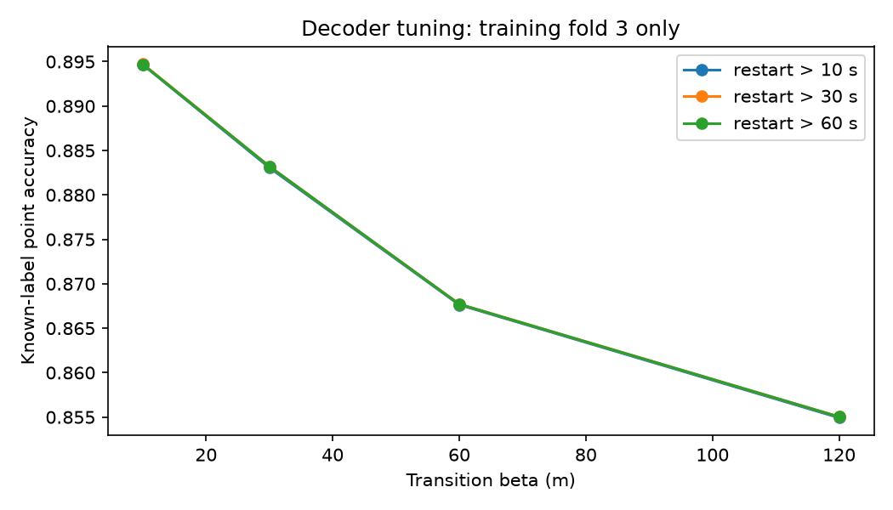
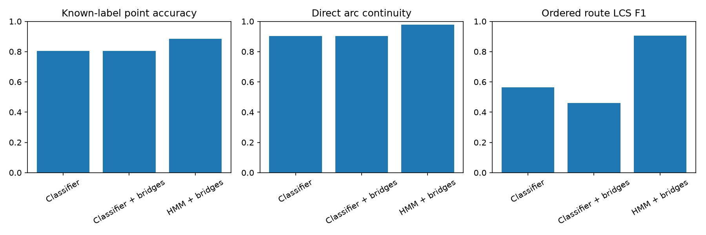
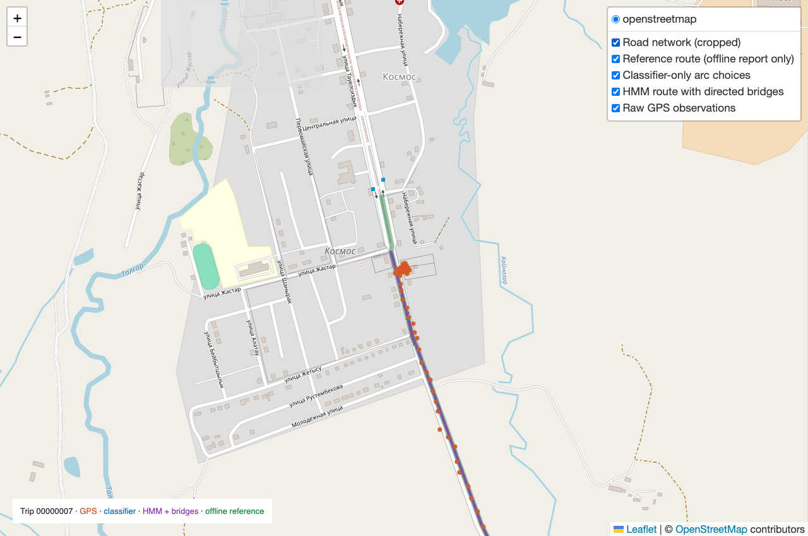
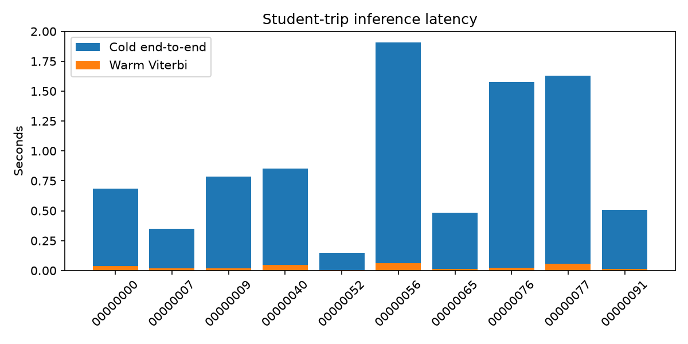
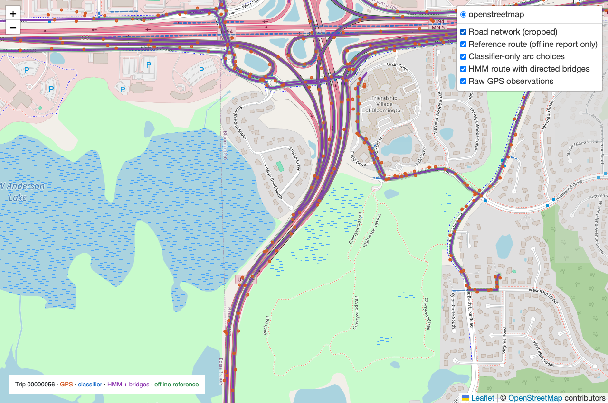

# Member 3 report source: HMM, Viterbi and route maps

Sections 5 and 6 for Member 4's single consolidated PDF. Code and prose were
prepared with Codex AI assistance. Every number below is from executed local
runs. The evaluator partition was not accessed.

## 5. HMM/Viterbi route reconstruction

### Hidden states, emissions and transition weights

A state is a directed candidate arc at one GPS observation. IDs remain zero-based
rows of that trip's `.arcs` file. Candidate generation and the classifier retain
the frozen Member 1 schema and Member 2 final model. There is no global arc-ID
classifier and no reference-route input during prediction.

The calibrated classifier's positive probabilities are clipped away from zero,
normalised within each observation and logged. Per-observation normalisation is
a common factor across all paths and therefore does not change the Viterbi
argmax. These are discriminative emission potentials, not a claim that the
classifier learned a generative GPS likelihood.

Directed route distance includes the remaining fraction of the previous arc,
a shortest directed path from its end node to the next arc's start node, and
the travelled fraction of the next arc. On the same arc, forward progress uses
its direct along-arc distance; backward motion up to
20 m is treated as GPS jitter. Larger reverse
movement needs a directed loop. Parallel directed arcs are retained, not summed
into an inflated graph-matrix edge weight.

The transition log weight is `-|route_distance - GPS_displacement| / beta` for
reachable pairs and negative infinity for impossible pairs. These exponential
weights are not row-normalised empirical traffic transition probabilities.
The recurrence is a weighted HMM-style chain:

`delta[t,j] = log_emission[t,j] + max_i(delta[t-1,i] + log_transition[t,i,j])`.

Backpointers recover the globally best candidate chain within each continuous
segment. A shared score offset is subtracted at each step to keep arithmetic
stable; it preserves the path argmax. Candidate ordering makes score ties
choose lower arc IDs deterministically. Tests compare the recurrence with
exhaustive enumeration on a small chain.

This design follows the road-distance versus observed-displacement principle in
[Newson and Krumm (2009)](https://www.microsoft.com/en-us/research/publication/hidden-markov-map-matching-noise-sparseness/),
using our learned emissions, directed endpoint handling and explicit restart
rules. We do not claim to reproduce their experiment. No data was downloaded
from that paper; all runs used the organiser-provided development partitions.

### Missing candidates, gaps and disconnected roads

Actual feature generation supplies a nearest-arc fallback when the radius is
empty. The decoder additionally handles an empty observation by returning arc
`-1` and restarting afterwards. This sentinel is never used as a Python negative
network index. Actual student runs must still predict every observation.
Nonpositive time intervals, gaps above the selected threshold, spatial jumps
above 5000 m and chains with no feasible transition
start a new segment. Restart reasons are recorded. Impossible transitions do not
receive an invented road connection or straight connector geometry.

Dijkstra searches are bounded by GPS displacement plus
500 m, capped at 5000 m.
Source searches use 100 m cutoff buckets and an LRU cache; reconstructed paths
are checked against the exact cutoff. Routes outside this bounded search are
considered unavailable, not proven globally disconnected. A 16-candidate cap
limits dynamic-programming state size; all selected-candidate tables retain IDs.

### Decoder tuning and data separation

A separate scorer used 48 training trips for base
fitting, 16 disjoint trips for sigmoid
calibration, and 16 further training trips for decoder
tuning. All trip sets are recorded in `hmm_tuning_model.json`. This avoids tuning
on predictions from the final classifier fitted on all 80 trips. The base family
and parameters were selected earlier using training CV, so this is not independent
of all prior model selection and is not nested CV.

The grid used beta `[10,30,60,120]` m and restart gaps `[10,30,60]` s: twelve
configurations, with all observations from all sixteen tuning trips. Primary
selection was known-label micro point accuracy. Ties use direct continuity,
fewer restarts, larger beta, then a smaller restart gap. Student test did not
select parameters. Frozen settings are in `configs/hmm.json`:

```json
{
  "transition_beta_m": 10.0,
  "gap_restart_s": 30.0,
  "path_margin_m": 500.0,
  "max_route_distance_m": 5000.0,
  "backtrack_tolerance_m": 20.0,
  "candidate_cap": 16
}
```



### Classifier-only versus decoding

Point accuracy compares every known observation label, including candidate
misses; unknown aligned labels are excluded and counted. Those labels are
approximate route-to-point supervision, not independently verified physical
truth. Distance/heading also influenced alignment, so high agreement has that
limitation. Reference-route imperfections remain documented in Member 1's EDA.

Direct continuity keeps B's definition: identical arcs or exact directed
head-to-tail adjacency between consecutive observation predictions. All points,
including unknown labels and time gaps, participate. This is intentionally
stricter than being connected by an intermediate road path.

Ordered sequence precision/recall use the longest common subsequence of arc
occurrences against the original reference `.route`; F1 is their harmonic mean.
Repeated arc IDs remain distinct ordered occurrences. This is neither a set
Jaccard score nor edit accuracy. Flattening restarted segments for LCS preserves
arc order but does not itself penalise a break; restart/segment counts and direct
continuity are therefore reported separately. Sequence endpoints may differ when
GPS covers only part of the supplied route.

The bridge-only control applies identical bounded path reconstruction to greedy
classifier choices. It leaves point labels unchanged and reveals how much sequence
improvement comes from inserting intermediate road arcs rather than Viterbi.

| partition | variant | n_known_obs | n_unknown_obs | pointwise_accuracy | route_continuity | sequence_precision | sequence_recall | sequence_f1 | decoder_restarts |
| --- | --- | --- | --- | --- | --- | --- | --- | --- | --- |
| decoder_tuning | classifier | 29420 | 2998 | 0.8100 | 0.9169 | 0.4474 | 0.8573 | 0.5880 | 0 |
| decoder_tuning | classifier_bridged | 29420 | 2998 | 0.8100 | 0.9169 | 0.2739 | 0.9765 | 0.4278 | 0 |
| decoder_tuning | hmm | 29420 | 2998 | 0.8947 | 0.9792 | 0.7019 | 0.9936 | 0.8227 | 6 |
| student_test | classifier | 19143 | 17 | 0.8036 | 0.9038 | 0.4223 | 0.8530 | 0.5649 | 0 |
| student_test | classifier_bridged | 19143 | 17 | 0.8036 | 0.9038 | 0.3023 | 0.9738 | 0.4614 | 0 |
| student_test | hmm | 19143 | 17 | 0.8846 | 0.9792 | 0.8355 | 0.9862 | 0.9046 | 5 |

On student test, classifier accuracy was 80.3584%; HMM
accuracy was 88.4605%. Direct continuity changed from
90.3812% to 97.9164%. Ordered route F1
was 0.5649 for raw classifier arcs,
0.4614 with bridging alone and 0.9046 with HMM
and bridging. Bridging alone increased ordered recall from 0.8530
to 0.9738, while precision fell from
0.4223 to 0.3023: filling paths
between noisy greedy choices adds many arcs outside the supplied ordered reference.
The HMM result therefore is not explained merely by adding intermediate arcs.
Tuning-set results are development scores after parameter selection,
not held-out performance estimates.



### Cases where HMM did not help

HMM had lower point accuracy than the classifier on 1 student trips.
The lowest per-trip changes were:

| trip_id | classifier | classifier_bridged | hmm | hmm_change |
| --- | --- | --- | --- | --- |
| 00000007 | 0.9106 | 0.9106 | 0.8486 | -0.0620 |
| 00000052 | 0.9275 | 0.9275 | 0.9618 | 0.0344 |
| 00000000 | 0.9253 | 0.9253 | 0.9596 | 0.0344 |

On the lowest-gain trip `00000007`, 93
known observations changed from classifier-correct to HMM-wrong, while
9 changed in the opposite direction.
This is a net loss of 84
correct labels. The offline failure screenshot focuses on one of the first group;
it is chosen after the decoder is frozen and does not influence tuning.



These cases must be interpreted alongside the measured changes, not hidden by
an aggregate. Hard topology constraints can favour a connected alternative when
candidate coverage, the road network, scorer probabilities or aligned labels are
wrong. A bounded search can also miss a longer valid detour. Per-trip rows, route
F1 and explicit restarts are in `hmm_comparison_by_trip.csv`; they do not establish
which input is physically correct in an ambiguous case.

### Latency and large trips

The largest student trip `00000056` has 3,958 points and
27,631 directed arcs. Its cold end-to-end inference took
1.906 s, including loading/projection, feature generation,
scoring, transition preparation, Viterbi and route expansion. With transitions
already prepared, Viterbi took 0.061 s. Model loading
is excluded when the batch reuses the startup scorer, as the future API should.
The provisional cold student target is 10 s, not an agreement invented with
Member 4. Maximum observed student cold time was 1.906 s.

The largest training trip `00000054` has
19,313 points. Its cold total was
5.053 s and warm Viterbi
0.282 s. It is used for speed only; its classifier
was fitted on training data, so its quality is not presented as generalisation.
A separate warm-graph cap-8 diagnostic is recorded but does not change the frozen
16-state configuration or student results. Detailed stages/cache counts are in
`decode_timing.csv`. Student cache counters include the later offline comparison
work, as labelled in `cache_scope`; the timed prediction stages exclude that work.



## 6. Geographical visualisation

All ten student maps are committed as `maps/pred_<trip_id>.html`. Layers include
raw GPS, cropped road geometry, classifier-only arc choices, HMM routes with
directed bridges, and the supplied reference route for the offline report only.
Colours, a legend, per-point tooltips, fitted bounds and layer controls distinguish
them. Predicted geometry consists of real road arcs; no straight road connector
is drawn across a restart. The generic map function adds a reference layer only
when explicitly supplied one by offline evaluation. API/UI inference must omit it.

Open [the largest student trip](../../maps/pred_00000056.html).
`src.visualization.render_maps` verifies all ten actual Folium pages and captures
the largest-trip and lowest-gain-trip views. The screenshot below is an actual
headless Chromium rendering with road layers, controls, legend and OpenStreetMap
tiles, not a manually fabricated map. Checks, browser version and focus observations
are in `folium_render_checks.json`. GPS display markers are subsampled to at most
700 per page; all observations still participate in decoding and evaluation.



## Reproducibility and handoff

Run `python -m src.hmm.run_member3` after Members 1 and 2. Prediction uses
`src.hmm.predict.predict_trip()` or `decode(cands,network,params)` and never opens
`.route`. Offline comparison opens references only after prediction. The final
model is preserved; frozen decoder parameters, data/model/source fingerprints,
all grid rows, per-trip comparisons, timing logs and maps are retained. Member 4
still owns API/UI integration, two-laptop checks and final PDF assembly.
